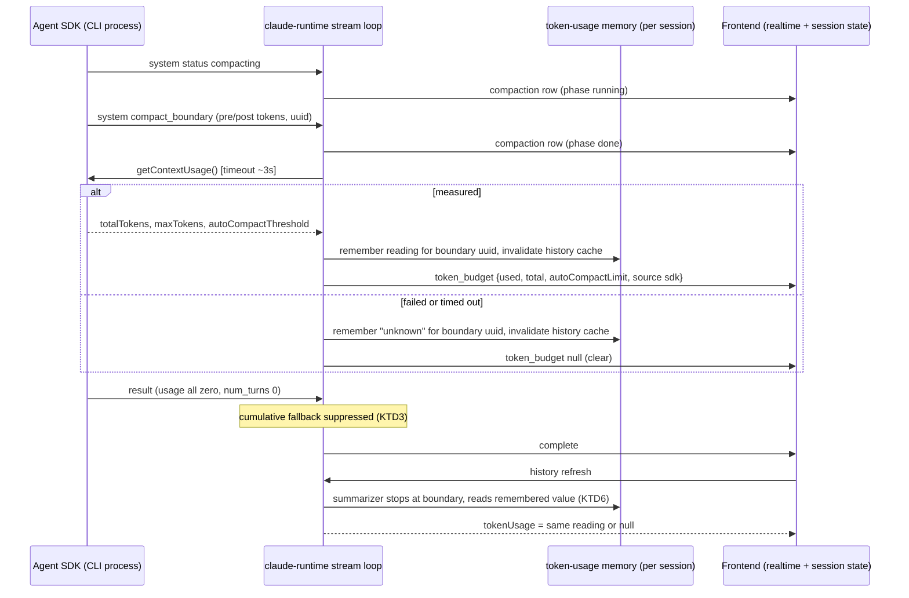
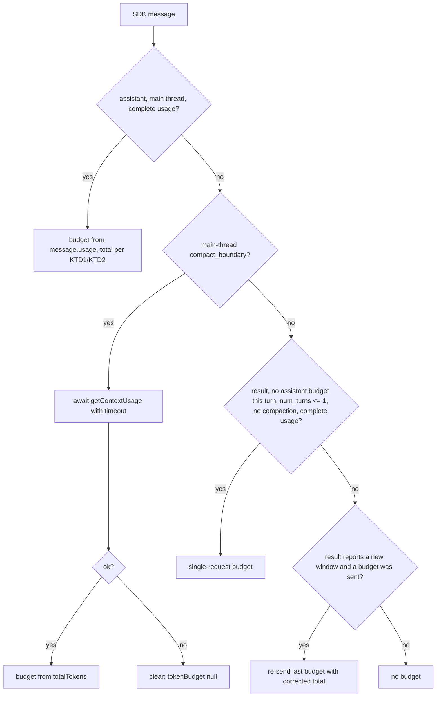

# Context Data (Lane A) - Plan

**Target repo:** the CloudCLI fork `Umelainteligence-cz/claudecodeui` (Brain Chat), branch cut from `feat/context-ring`; PR goes into `feat/context-ring`.

---

## Goal Capsule

- **Objective:** A Brain Chat user looking at the composer's context ring, token pill, or `/cost` sees how full the session's context window really is, for any Claude model (200k or 1M). A compaction shows in the transcript as one clear row, and the reading drops right after `/compact` without a reload.
- **Means:** Port upstream #1557 (window from the SDK), #1295 (compaction row) and the #1288 guard. Then, fork-only, read `Query.getContextUsage()` after each `compact_boundary` and make both the live and history readers aware of the boundary (KTD1-KTD6).
- **Authority:** the coordinator's brief and the Lane A/B contract outrank this plan. This plan outranks upstream PR text. Code evidence outranks dossier claims.
- **Stop conditions:** stop and `ask` the coordinator if any of these happen:
  - the `tokenBudget` shape would need a non-optional change;
  - a change is needed in a Lane B file (`src/modules/chat/composer/**`, `useChatComposerState.ts`, `src/shared/uiPreferences.ts`, settings toggles);
  - the live probe in U4 shows `getContextUsage()` cannot answer while the stream loop awaits it;
  - the live probe in U4 shows the streamed `compact_boundary` uuid differs from the uuid written to the JSONL (KTD5/KTD6 key readings by that uuid).
- **Execution profile:** server-heavy TypeScript/JS with node:test, plus a small client part with vitest. Work test-first where a scripted SDK stream can express the behaviour.
- **Finishing and shipping:** this worker finishes the work, opens a PR into `feat/context-ring`, and does not merge it.

---

## Product Contract

### Summary

Make every Claude context number the server sends true:
- `total` is the model's real window from the SDK;
- `used` never comes from a turn's cumulative bill;
- after a compaction, the next reading is the SDK's own post-compact measurement, or an explicit "unknown" (`null`).

Also show a compaction as one transcript row, live and from history, with the summary folded in.

### Problem Frame

Brain Chat is getting a context ring (Lane B) that fills green → amber → red and offers `/compact`. The numbers behind it are wrong today:
- **Window:** every Claude model is measured against the `CONTEXT_WINDOW` env value (default 160,000). A 1M model reads as over 100%.
- **Manual `/compact`:** the turn emits no assistant message, so the turn's `result.usage` is published as current occupancy. In SDK 0.3.165 that usage is all zeros. Right after, the history refresh restores the last pre-compact reading. The ring either drops to 0 or snaps back to full.
- **Transcript:** the compaction itself never shows, because the live normalizer drops every `type:'system'` message.

A ring built on these numbers would mislead the user exactly when they need it.

### Requirements

**Window (total)**
- R1. For Claude sessions, `tokenBudget.total` (live `token_budget` frames, history page `tokenUsage`, and the `/token-usage` endpoint) equals the SDK-reported `result.modelUsage[mainModel].contextWindow` once any turn of the session has reported it. The most recently reported window wins, so switching a session to another model takes effect at that turn's `result`. Until then, `CONTEXT_WINDOW` is used, and 160,000 when that is unset.
- R2. A subagent model's window is never chosen as the session's window.

**Occupancy (used)**
- R3. `used` comes only from a main-thread assistant usage, from a `getContextUsage()` measurement, or from the single-request `result` fallback (KTD3). It never comes from a multi-request or compaction turn's `result`/`modelUsage` bill.
- R4. All-zero or incomplete usage frames (`<synthetic>` notices, API errors) never publish a budget and never block a later real one.

**Compaction**
- R5. After a manual or auto compaction, the frontend receives a fresh `token_budget` for that session before the turn's `complete`. Its `used` is the SDK's post-compact `totalTokens`. If that measurement is unavailable, fails, or times out, the frontend receives an explicit clear, and the session's budget becomes `null`.
- R6. The history-derived `tokenUsage` for a session whose newest usage-relevant entry is a `compact_boundary` returns the remembered post-compact reading for that boundary, or `null`. It never returns the last pre-compact assistant usage.
- R7. A `compact_boundary` renders as one transcript row showing trigger, pre → post tokens and duration, with the compaction summary folded in as an expandable section. This holds live and when reloading history.
- R8. The compaction row and the compaction summary are never read aloud by voice auto-speak.

**Contract and other providers**
- R9. The `tokenBudget` shape stays backward compatible. The only additions are the optional `contextWindowSource: 'sdk' | 'env' | 'default'` and `autoCompactLimit?: number` (the SDK's own `autoCompactThreshold`, never derived).
- R10. Codex, OpenCode and Cursor token behaviour is unchanged. Cursor still reports no usage.
- R11. `/cost`'s "Context window" row shows a number only when that number is true for the session. For Claude, that means a window the SDK reported. Other providers keep today's row (R10).

### Key Decisions

- **Clear-to-null fallback after compaction (session-settled: user-approved — chosen over showing `post_tokens` as an estimate: `post_tokens` understates real context 3-9x because it excludes system prompt and tools).** The coordinator approved this on 2026-10-16. They require a short timeout on the call and tests pinning three cases: success, failure → null, and a zero result being ignored. While the budget is `null`, Lane B hides the ring (the coordinator instructed Lane B on 2026-10-16), and the pill shows nothing. The next main-thread assistant usage restores a number. Governs R5, R6.

### Acceptance Examples

- AE1. **Covers R1.** **Given** a turn whose `result.modelUsage` has `"claude-opus-5-5[1m]": {contextWindow: 1000000}` and assistant rows naming `claude-opus-5-5`, **then** the last `token_budget.total` is 1,000,000 and `contextWindowSource` is `'sdk'`.
- AE2. **Covers R1.** **Given** `CONTEXT_WINDOW=123456` and no reported window, **then** every budget has `total: 123456` and `contextWindowSource: 'env'`. With the env unset, it is 160,000 and `'default'`.
- AE3. **Covers R5.** **Given** a manual `/compact` stream (`status: compacting` → `compact_boundary` → `result` with zero usage) and `getContextUsage()` resolving `{totalTokens: 41000, maxTokens: 1000000, autoCompactThreshold: 967000}`, **then** one `token_budget` `{used: 41000, total: 1000000, autoCompactLimit: 967000, contextWindowSource: 'sdk'}` is sent before `complete`, and the zero `result` sends none.
- AE4. **Covers R5.** **Given** the same stream but `getContextUsage()` rejects or exceeds the timeout, **then** a `token_budget` with `tokenBudget: null` is sent before `complete`, and the frontend's budget for that session becomes `null`.
- AE5. **Covers R6.** **Given** a JSONL whose last entries are an assistant row (950k used), then a `compact_boundary`, then the summary user row, **then** history `tokenUsage` is the remembered post-compact reading when one exists, else `null`, never 950k.
- AE6. **Covers R7.** **Given** a history page with a boundary (`preTokens 335000`, `postTokens 10000`, manual, 142 s) followed by its summary row, **then** the transcript shows one row "Compacted · manual · 335k → 10k tokens · 2m 22s" with the summary under an expandable "full summary".

### Scope Boundaries

- Persisting the reported window or post-compact reading across server restarts is a non-goal. Both live in process memory, as upstream #1557 does. After a restart, history falls back to `CONTEXT_WINDOW` (marked `'env'`/`'default'`) until the session's next turn. Evidence that would change this: Brain Chat restarting often enough that users regularly see `'env'` totals.
- Deriving `autoCompactLimit` from `contextWindow − min(maxOutputTokens, 20000) − 13000` is not built. Env and settings overrides (`CLAUDE_CODE_AUTO_COMPACT_WINDOW`, `CLAUDE_AUTOCOMPACT_PCT_OVERRIDE`, `CLAUDE_CODE_MAX_OUTPUT_TOKENS`) are invisible to the server, so the result would be a guess. This would change if the SDK exposed the threshold on `result`.
- #1541 (sum every `modelUsage` entry) is declined. It makes a bill-as-occupancy reading larger, which goal 3 forbids, and its branch never runs on SDK 0.3.165, which always sends `result.usage`.
- #1566's transcript-read fallback is declined. It addresses a gateway-only problem the maintainer has not reproduced, and it adds file I/O inside the stream loop. Only its `assistantBudgetSent` reset is taken.
- A forked session, or one resumed under a new provider id, shows an `'env'`/`'default'` total until its next turn, because remembered windows are keyed by provider session id. Accepted: post-compact readings are keyed by boundary uuid, so copied boundary rows still match.
- Considered and not built:
  - **One post-compact slot per session.** A global map keyed by boundary uuid, with the same LRU cap, bounds memory just as well and survives forks that copy boundary rows.
  - **Overlaying the remembered reading at read time instead of invalidating the cache.** A generation counter in the history cache (KTD6) is smaller and keeps #1557's `invalidate` API for future upstream merges. Evidence that would change this: a second cache consumer needing fresh `tokenUsage`.
  - **Calling `getContextUsage()` after every turn.** This would change the `used` source for every turn, which is out of this lane's scope. The U4 probe records its latency as input for a follow-up.
  - **Timing `getContextUsage()` on a large real session.** Opening a real session risks sending it a prompt. The bounded timeout with clear-to-null covers slow calls. The probe records latency on its own throwaway session.
  - **Guarding reconnect replay order.** The run registry relays frames in order (`server/modules/websocket/services/chat-run-registry.service.ts`), and there is no evidence of reordering.
- The composer ring, pill, the click-to-compact flow and the new i18n namespace for them are Lane B's work.

#### Deferred to Follow-Up Work

- Translating the two compaction-row strings into the 10 non-en/cs locales. `t()` falls back to the English default.

---

## Planning Contract

### Key Technical Decisions

- KTD1. **Window from the SDK per provider session, in process memory (port of #1557).** `readReportedContextWindow` picks the main thread's model:
  - exact key match first;
  - then a `canonicalModel` match or the key with its `[..]` suffix stripped;
  - otherwise the only entry, if there is just one.

  The result goes into a capped `Map` in `provider-token-usage.service.ts`. The runtime, `getSessionTokenUsage`, and the Claude history reader all read it. Rationale: only `result.modelUsage` states the window, the JSONL never records it, and model ids cannot tell a 200k build from a 1M build.
- KTD2. **`contextWindowSource` is decided where the window is resolved.** `resolveContextWindow` returns both the number and its source: `'sdk'` (reported), `'env'` (`CONTEXT_WINDOW` parses to an integer > 0), or `'default'` (160,000; this also covers `0` and garbage). The runtime and the history summarizer share this one parse, so live and history agree. Today the runtime treats `0` as unset while the summarizer accepts it. The source travels on every Claude budget, live and from history. This is one owner for both number and label. `.env.example` ships `CONTEXT_WINDOW=160000`, so typical deployments report `'env'`, not `'default'`.
- KTD3. **The cumulative `result` fallback publishes only a single-request account.** It runs only when all of these hold:
  - no assistant budget was sent this turn;
  - `num_turns <= 1`;
  - the turn had no `compact_boundary`;
  - the usage passes the KTD4 guard.

  Otherwise it publishes nothing. `assistantBudgetSent` and the turn's compaction flag reset together after every `result` (the reset is from #1566), so a held process's follow-up turn gets its own decision. Keeping the narrowed function, rather than deleting it, keeps the fork's diff against upstream small.
- KTD4. **Port #1288's completeness guard into `extractTokenBudget`.** It returns null when either cache field is absent or when the summed input is ≤ 0. Applied to the cumulative path as well.
- KTD5. **Post-compact reading: await `getContextUsage()` inside the stream loop, bounded by a timeout.** On a main-thread `compact_boundary`:
  1. Await `queryInstance.getContextUsage()` raced against a timeout, through a small helper next to `BG_WAIT_CEILING_MS`. The helper:
     - checks `typeof getContextUsage === 'function'`;
     - wraps the call so a synchronous throw becomes a rejection;
     - calls `unref()` on its timer and clears it in a `finally` on every path;
     - ignores late results.

     The timeout (about 3 s) is overridable through the runtime context, so tests use about 20 ms.
  2. If the run was superseded or aborted while waiting (`supersededInstances`, `abortedSessionIds`), emit and store nothing.
  3. On success, emit `{used: totalTokens, total, autoCompactLimit: isAutoCompactEnabled ? autoCompactThreshold : undefined, contextWindowSource: 'sdk'}` along with the usual breakdown fields (zeros where the SDK gives none). `total` is the window `getContextUsage()` itself reports: whichever of `rawMaxTokens` and `maxTokens` the probe shows to be the real window. This measurement is newer than the remembered window and follows a model switch. The remembered window is used only when the response carries none.
  4. On failure or timeout, emit a clear (`tokenBudget: null`).
  5. After step 3 or step 4 (never after step 2), record the outcome under the boundary's `uuid` in a global, LRU-capped map (1,000 entries, delete-then-set ordering). Uuids are global, and the SDK type requires one (`sdk.d.ts:2721`).
  6. Reset `lastSentTokenBudget` so #1557's re-send cannot revive a pre-compact `used`.

  The call is awaited, not fire-and-forget, because that holds back `result` and `complete` until the reading is stored. This closes three races:
  - with the history refresh;
  - with the process release on a `/compact` turn;
  - with a newer assistant reading during auto-compact.

  `getContextUsage` is a control request answered by the live CLI process. The SDK routes `control_response` frames independently of the consumer, so the await cannot deadlock. During an auto-compact in the middle of a turn, the UI's stream pauses for up to the timeout. The SDK buffers frames, so nothing is lost.
- KTD6. **The history summarizer is boundary-aware.** It walks newest → oldest over non-sidechain entries:
  - It stops at the first assistant row with real usage, as today.
  - Or it stops at the first `system`/`compact_boundary`. In that case it returns the remembered reading for that boundary's uuid, or `null` (meaning "unknown").

  `summarizeClaudeTokenUsage` and `getSessionTokenUsage` widen their return types to `TokenUsageResult | null`. Both callers (`fetchHistory` and the token-usage service) pass the same remembered inputs, and the service receives the post-compact lookup through `ProviderTokenUsageServiceDependencies` (as #1557 does for the window). `claudeEntriesHaveUsage` treats a main-thread boundary as decisive, so a 4 MB tail holding only a boundary and its summary does not force a full-file read.

  Each stored reading or window change invalidates the history cache under `sessionKey()`, the app session id the cache is keyed by. `invalidate` bumps a per-session generation and deletes that session's `pendingLoads` entry. A load that started under an older generation does not write its result, and a request arriving after `invalidate` starts a fresh load instead of joining the stale one. Without the generation, an in-flight load would re-cache the stale value. The cache's header comment ("no invalidation hooks") is updated to match.
- KTD7. **Port the compaction row as #1295 shaped it:** `kind:'text'`, `role:'assistant'`, plus `compact: CompactionInfo`. The client folds the summary in via `normalizedToChatMessages`. When the newest assistant-side row of a finished turn is a compaction row or its summary, voice auto-speak's `speakFinishedTurn` returns early, after ending the run and before the `no_summary` branch, with no note and no announcement. Skipping those rows inside `lastAssistantText` alone would still post a "no summary" note. Rationale: keeping upstream's shape keeps future merges clean. Changing the kind to `task_notification` would fork #1295's client fold. The voice skip is one predicate in `src/modules/chat/voice/autoSpeak.ts`, a fork overlay file that neither lane owns. It is the smallest fix for R8 (see Risks).
- KTD8. **The frontend handles an explicit clear.** In `useChatRealtimeHandlers`, a `status` frame with `text === 'token_budget'` is always treated as a budget frame. When `'tokenBudget' in msg` and its value is `null`, it calls `setTokenBudget(null)` for the active session. A `token_budget` frame never falls through to `onSessionProcessing`.
- KTD9. **`/cost` row truthfulness.** The `/cost` handler passes `contextWindowSource` through. When the client budget is null or absent, the handler omits `tokenUsage` instead of defaulting it to `{used: 0, total: 0}`. `CostContent` hides the "Context window" row when `contextWindowSource` is present and is not `'sdk'`. A budget without the field (Codex, OpenCode) keeps today's `total > used` rule (R10, R11). A budget with no `tokenUsage` shows "Total tokens used: Unknown" and no "Context window" row, never a 0 reading. The labels stay hard-coded English, like the rest of `CostContent`.
- KTD10. **Type placement and the Lane B boundary:**
  - `ContextWindowSource` and `CompactionInfo` live in `server/shared/types.ts`, since they have more than one consumer. Each has a doc comment and its own appended section.
  - The client copies live in `src/shared/types.ts`, also in an appended section. Appending keeps them clear of Lane B's edits near `ComposerMenuAnchor`.
  - The client `TokenBudget` is exported as a type alias only, which stays assignable to `Record<string, unknown>`. The `tokenBudget` state, its setter, and `UseChatRealtimeHandlersArgs` keep their current types, because narrowing them would break Lane B's `ChatComposer.tsx`.
- KTD11. **`claude-runtime.provider.js` stays JavaScript.** This is an explicit exception to the backend standard's "migrate touched JS to TS", made to keep upstream merge parity with #1557, #1295 and #1288, which all edit this file as JS.

### High-Level Technical Design

Manual `/compact` turn: what the server sends, and in what order.

Budget source decision per SDK message (directional):

### Assumptions

- The streamed `compact_boundary` carries the same `uuid` that the CLI writes to the JSONL row. The SDK type requires `uuid` (`sdk.d.ts:2721`), but equality with the on-disk row is unverified. U4's probe checks it, and a mismatch is a stop condition.
- `getContextUsage()` resolves while the `for await` loop is paused on it, and it is fast enough (well under 3 s) and makes no paid API call. U4 confirms this with a live probe before the rest of U4 is built on it.
- Whether the live stream delivers the compaction summary as a flagged user message is unverified. #1295's fold handles both orders and both flag states, so the plan does not depend on it.
- Brain Chat runs one server process per workspace, so process memory is the right scope for remembered readings.

### Sequencing

U1 → U2 → U3 → U4 → U5 → U6. U7 depends only on U1's types and can run after U2. U8 follows U2 and U4. U9 comes last.

---

## Implementation Units

### U1. Testable runtime seam

- **Goal:** Let tests drive `queryClaudeSDK` with a scripted SDK stream, so that every later unit can prove loop-level behaviour.
- **Requirements:** supports R1-R6 (test infrastructure).
- **Dependencies:** none.
- **Files:**
  - `server/shared/types.ts`: optional `createQuery?` on `ProviderRuntimeContext`, as in upstream #1347.
  - `server/modules/providers/list/claude/claude-runtime.provider.js`: use `context.createQuery ?? query` at both call sites (with hooks, and the retry without hooks).
  - `server/modules/providers/tests/scripted-claude-sdk.ts`: a new `runScripted(appSessionId, stream, {resumeProviderSessionId, getContextUsage, contextUsageTimeoutMs})` helper. It is flat in `tests/`, like the repo's other test helpers, and has no `.test` suffix, so the test glob skips it. It returns the sent frames. Its fake query object supports `interrupt` and a stubbable `getContextUsage`.
- **Approach:**
  1. Take upstream's `runScripted` from #1557 (upstream commit `5d76a2d8`).
  2. Construct `new ClaudeSessionsProvider()` with no arguments, because the fork's constructor takes none.
  3. Make the scripted stream end deterministically: the helper drains, then releases the held prompt, so no idle-release timer survives between tests.
- **Patterns to follow:** upstream `server/modules/providers/tests/claude-context-window.test.ts` harness; the `codex-runtime.test.ts` runtime-context fakes.
- **Test scenarios:**
  - A scripted stream of `system init` → assistant → `result` yields a `token_budget` frame and a `complete` frame, and no real CLI is spawned.
- **Verification:** the helper's smoke test passes, and existing server tests are unchanged.

### U2. Per-model window and its source (port #1557 + KTD2)

- **Goal:** Make `total` the real per-model window, live and in history, and label where it came from.
- **Requirements:** R1, R2, R9, R10.
- **Dependencies:** U1.
- **Files:**
  - `server/modules/providers/list/claude/claude-runtime.provider.js`
  - `server/modules/providers/services/provider-token-usage.service.ts`
  - `server/modules/providers/list/claude/claude-sessions.provider.ts`
  - `server/modules/providers/services/session-history-cache.service.ts`: `invalidate(sessionId)` with the per-session generation (KTD6), and an updated header comment.
  - `.env.example` and `server/modules/cli/cli.service.ts`: comment and help text only.
  - Tests:
    - `server/modules/providers/tests/claude-context-window.test.ts` (new)
    - the history-cache test next to the cache (existing, or new `session-history-cache.test.ts`)
- **Approach:**
  1. Apply upstream commit `5d76a2d8` (#1557) with a three-way apply.
  2. Hand-port the two import hunks that fail (runtime and sessions provider).
  3. Do not take its `CommandResultModal.tsx` comment hunk; U8 owns that file.
  4. Add the cache `invalidate`, and import the cache into the runtime. Invalidate with `sessionKey()` (the app id). Remember windows with `message.session_id || capturedSessionId`.
  5. Extend `resolveContextWindow` to return a source per KTD2. Carry `contextWindowSource` on every budget from `buildTokenBudget`, `extractCumulativeTokenBudget` and `summarizeClaudeTokenUsage`.
  6. Inject `getReportedClaudeContextWindow` into the token-usage service's dependencies.
  7. Leave the Codex and OpenCode summarizers untouched (R10).
- **Execution note:** port upstream's six tests first and watch them fail before the source change.
- **Patterns to follow:** upstream commit `5d76a2d8` (`git show 5d76a2d8` in this clone).
- **Test scenarios:**
  - Covers AE1. A `[1m]` key against a bare `message.model` gives `total` 1,000,000 and source `'sdk'`.
  - With `CONTEXT_WINDOW=160000`, a reported 200,000 wins.
  - With a subagent model (haiku, 200k) and a main model (`opus[1m]`) both in `modelUsage`, `total` is 1,000,000.
  - Covers AE2. No reported window with the env set gives the env value and `'env'`. With the env unset, it gives 160,000 and `'default'`.
  - History after a run uses the reported window (262,144). A session that never ran uses the fallback.
  - A resumed session's first budget already has the remembered window, with no 160,000 flash.
  - The window changing invalidates that session's cached history page.
  - `CONTEXT_WINDOW=0` or a non-number gives 160,000 and `'default'`, identically live and in history.
  - `invalidate` called while a history load is in flight: the finished load does not re-cache. A read issued after `invalidate`, while the old load is still pending, returns the recomputed value.
- **Verification:** all scenarios pass, and `provider-token-usage.service.test.ts` stays green. Codex and OpenCode tests are unchanged.

### U3. Honest `used`: guard, per-turn reset, narrowed fallback

- **Goal:** Make sure no zero, incomplete, or cumulative account is ever published as occupancy.
- **Requirements:** R3, R4.
- **Dependencies:** U2.
- **Files:**
  - `server/modules/providers/list/claude/claude-runtime.provider.js`
  - Tests: `server/modules/providers/tests/claude-token-budget.test.ts` (extend) and `server/modules/providers/tests/claude-context-window.test.ts`, or a new `claude-budget-honesty.test.ts` for the loop-level cases.
- **Approach:**
  1. Port #1288's guard (KTD4) from `gh pr diff 1288 -R siteboon/claudecodeui`, adapting its return line to pass the reported window.
  2. Reset `assistantBudgetSent` and `compactedThisTurn` after each `result`.
  3. Gate the cumulative call per KTD3, using `compactedThisTurn` and the result's top-level `num_turns`.
- **Test scenarios:**
  - A `<synthetic>` assistant with all-zero usage publishes nothing, and a later real assistant still publishes.
  - Usage missing `cache_read_input_tokens` publishes nothing.
  - A turn with no assistant usage and `result {num_turns: 1, usage: non-zero}` publishes the single-request budget.
  - The same with `num_turns: 3` publishes nothing.
  - Covers AE3 (zero half). A `result` with all-zero usage after a `compact_boundary` publishes nothing.
  - A held process with two `result`s: the second turn gets its own fallback decision, so the reset works.
  - A held process whose follow-up turn contains a `compact_boundary`: that turn's zero `result` publishes nothing.
- **Verification:** pure-function and loop-level tests pass, and the existing `claude-token-budget.test.ts` cases still pass or are updated with a stated reason.

### U4. Post-compact reading live (KTD5)

- **Goal:** Send the SDK's own post-compact measurement, or an explicit clear, before the compaction turn completes.
- **Requirements:** R5, R9; Key Decision (clear-to-null).
- **Dependencies:** U3.
- **Files:**
  - `server/modules/providers/list/claude/claude-runtime.provider.js`
  - `server/modules/providers/services/provider-token-usage.service.ts`: `rememberClaudePostCompactReading(boundaryUuid, reading | null)` and a matching getter, in a global LRU map capped at 1,000 entries. Each has a consumer comment, and the getter is injected into the service's dependencies (KTD6).
  - `server/shared/types.ts`: an optional `contextUsageTimeoutMs` on `ProviderRuntimeContext`, for tests.
  - Test: `server/modules/providers/tests/claude-compaction-budget.test.ts` (new).
- **Approach:**
  1. **Probe first, safely.** Write a standalone Node script in the scratchpad that uses the SDK's `query()` directly. It must never go through the dev server or a real Brain Chat session.
     - **Isolation:** a fresh empty temp `cwd`, `settingSources: []`, no MCP servers, a cheap model. It never resumes an existing session id.
     - **Run:** two or three short exchanges, then `/compact`. Write every frame to a file. Call `getContextUsage()` from inside the loop when the boundary arrives.
     - **Second run, auto-compact:** in the probe's environment only, set a very low `CLAUDE_AUTOCOMPACT_PCT_OVERRIDE` so that an ordinary turn triggers auto-compact in the middle of the turn. Check the same uuid and response behaviour on the path real Brain Chat sessions hit near the window limit.
     - **Record:**
       - the streamed boundary uuid against the uuid in the session's JSONL;
       - `maxTokens`, `rawMaxTokens` and `contextWindow`;
       - what `totalTokens` covers;
       - `apiUsage`;
       - the call's latency, and whether it made a network request;
       - whether the summary arrives flagged;
       - the gap between the post-compact reading and the next real turn's usage.

     Record all of this in the report. A uuid mismatch, or a call that cannot resolve, is a stop condition.
  2. Implement KTD5 for main-thread boundaries. The `parent_tool_use_id` check is defensive only, because the SDK type has no such field on boundaries.
- **Execution note:** if the probe shows the call cannot resolve during a paused loop, stop and `ask` (see Goal Capsule stop conditions).
- **Test scenarios:**
  - Covers AE3. Boundary → stub resolves → one `token_budget` with SDK fields arrives before `complete`, and the zero `result` adds nothing.
  - Covers AE4. The stub rejects, then a `token_budget` with `tokenBudget: null` arrives before `complete`.
  - Covers AE4. The stub never resolves (test timeout about 20 ms), so the clear is sent within the timeout, the loop continues to `result` and `complete`, and no timer is left pending.
  - The stub rejects after the timeout already fired: no unhandled rejection, and no second frame.
  - An abort or a superseding run while the call is pending: no frame is sent and nothing is stored.
  - `isAutoCompactEnabled: false` means `autoCompactLimit` is omitted.
  - The remembered window is 1M, and `getContextUsage()` reports a 200k window after a model switch: the post-compact `total` is 200k.
  - Auto-compact mid-turn (assistant → boundary → assistant → result): the post-compact assistant reading is the last budget, and order is preserved.
  - #1557's re-send after the boundary does not revive the pre-compact `used`.
  - A boundary with `parent_tool_use_id` triggers no call and no frame.
  - The reading is remembered under the boundary uuid, and the history cache is invalidated under the app session id.
- **Verification:** all scenarios pass, and the probe findings are written into the report.

### U5. Boundary-aware history usage (KTD6)

- **Goal:** Make the history refresh after `complete` (and every later reload) agree with the live post-compact reading instead of restoring the pre-compact one.
- **Requirements:** R6, R1.
- **Dependencies:** U4.
- **Files:**
  - `server/modules/providers/services/provider-token-usage.service.ts`
  - `server/modules/providers/list/claude/claude-sessions.provider.ts`
  - Tests:
    - `server/modules/providers/tests/provider-token-usage.service.test.ts` (extend)
    - type-narrowing updates where existing tests dereference `summarizeClaudeTokenUsage` or `getSessionTokenUsage` results: `provider-token-usage.service.test.ts` around lines 172-176, 233, 248, 252-255, 281, 304 and 368; `codex-message-editing.test.ts` around lines 330-340
- **Approach:**
  1. Stop the backward walk per KTD6, recognising both `compactMetadata` (disk) and `compact_metadata`.
  2. Pass the remembered window and post-compact lookup from both callers.
  3. Widen `getSessionTokenUsage` to `| null`, and make `claudeEntriesHaveUsage` treat a boundary as decisive.
  4. Leave the token-usage route unchanged. It already sends `null` as `data: null`, which the client maps with `?? null`.
  5. The history path keeps `tokenUsage: null` as an explicit key, so the store distinguishes "cleared" from "not provided".
- **Test scenarios:**
  - Covers AE5. Assistant (950k) → boundary → summary with a remembered reading returns the remembered reading.
  - The same without a remembered reading returns `null`.
  - Boundary → summary → a later assistant (93k) returns 93k.
  - Two compactions, where the latest has no remembered reading, returns `null`, not the first compaction's reading.
  - A sidechain boundary is ignored.
  - A transcript with no boundary behaves as before.
  - A 4 MB tail that holds only a boundary and its summary resolves without a full-file read.
- **Verification:** `npm run typecheck` passes, the new and existing summarizer tests pass, and `fetchHistory` returns the same value as `getSessionTokenUsage` for the same session.

### U6. Frontend accepts the clear (KTD8)

- **Goal:** Make the composer's session budget follow server clears without disturbing the processing indicator.
- **Requirements:** R5, R6.
- **Dependencies:** U4, U5.
- **Files:**
  - `src/modules/chat/hooks/useChatRealtimeHandlers.ts`
  - `src/modules/chat/hooks/useChatSessionState.ts`, only if the history `null` path needs a fix.
  - `src/shared/types.ts`: export a `TokenBudget` type alias with the two optional fields (KTD10). The `tokenBudget` state, its setter and the handler args keep `Record<string, unknown>`, so no Lane B file changes.
  - Tests: `src/modules/chat/tests/tokenBudgetSessionScope.test.tsx` and `src/modules/chat/tests/tokenUsageFreshness.test.tsx` (extend).
- **Test scenarios:**
  - A null `token_budget` for the viewed session sets the budget to `null`.
  - A null `token_budget` for another session leaves the viewed budget alone.
  - A null `token_budget` never calls `onSessionProcessing`.
  - A history refresh returning `tokenUsage: null` after a compaction clears a previously non-null budget.
  - A history refresh returning a reading with `contextWindowSource`/`autoCompactLimit` passes them through unchanged.
- **Verification:** the client suite is green.

### U7. Compaction transcript row (port #1295 + KTD7)

- **Goal:** Show a compaction as one row, live and from history, with the summary folded in, and keep it silent for voice.
- **Requirements:** R7, R8.
- **Dependencies:** U1. It is independent of U2-U6.
- **Files:**
  - `server/modules/providers/list/claude/claude-sessions.provider.ts`
  - `server/shared/types.ts` and `src/shared/types.ts`: `CompactionInfo`, in an appended section with its own doc comment (KTD10).
  - `src/modules/chat/hooks/useChatMessages.ts`
  - `src/modules/chat/transcript/MessageComponent.tsx`
  - `src/modules/i18n/locales/en/chat.json`: `misc.compacted` and `misc.compactionSummary`. `cs` already has both keys.
  - `src/modules/chat/voice/autoSpeak.ts`: early return in `speakFinishedTurn` for a compaction turn (KTD7), and `compact` / `isCompactSummary` added to its `TranscriptRow` type.
  - Tests: `server/modules/providers/tests/claude-compaction.test.ts` (new, from upstream), `src/modules/chat/tests/compactionRows.test.ts` (new, from upstream), and `src/modules/chat/voice/tests/autoSpeak.test.ts` (extend).
- **Approach:** apply upstream commit `d450ed85` (#1295), which applies cleanly. Check that the `voiceOffInvariance` snapshots still match. The new row only appears in compaction sessions, so the snapshots should be unaffected.
- **Test scenarios:**
  - Upstream's 6 server and 12 client cases.
  - Covers AE6. A history boundary followed by its summary renders one row with the summary folded in.
  - The live order (summary, then boundary) gives one row.
  - A failed compaction status gives a failed row.
  - A bare "Compacted" acknowledgement is dropped only when a compaction row exists.
  - The summary appears exactly once. This must hold with the fork's existing handling of `isCompactSummary` rows, in history and live, and `session-conversations-search.service.ts` still indexes the summary.
  - Auto-speak after a `/compact` turn whose last assistant rows are the compaction row and its summary speaks nothing and posts no `no_summary` note.
- **Verification:** server, client and voice tests are green.

### U8. Truthful `/cost` context-window row (KTD9)

- **Goal:** Make the "Context window" row in `/cost` true now that `total` can be the real window.
- **Requirements:** R11, R9.
- **Dependencies:** U2, U4.
- **Files:**
  - `server/modules/commands/commands.routes.ts` (the `/cost` handler passes `contextWindowSource` through and omits `tokenUsage` when the client budget is null)
  - `src/modules/chat/modals/CommandResultModal.tsx` (`CostContent` and its comment)
  - `src/shared/types.ts` (`CostCommandData.tokenUsage` gains the optional source)
  - Tests:
    - `src/modules/chat/tests/costContextWindowRow.test.tsx` (new `CostContent` render test)
    - `server/modules/commands/tests/commands.test.ts` (extend; covers passing `contextWindowSource` through and omitting `tokenUsage` for a null budget)
- **Test scenarios:**
  - Source `'sdk'` with total 1,000,000 and used 41,000 shows the row with 1,000,000.
  - Source `'env'` or `'default'` hides the "Context window" row, whatever `total` and `used` are.
  - A Codex-shaped budget (no source, total 258,400 > used) still shows the row, as today.
  - The `/cost` handler given a null client budget returns no `tokenUsage`.
  - `CostContent` rendered with no `tokenUsage` shows "Total tokens used: Unknown", no "0" usage value, and no "Context window" row.
- **Verification:** the render test is green, and a manual `/cost` check during QA matches.

### U9. Docs and fork notes

- **Goal:** Record what changed for the fork's maintainers and operators.
- **Requirements:** none directly; supports the Definition of Done.
- **Dependencies:** U1-U8.
- **Files:**
  - `.env.example` (from U2)
  - `docs/plans/2026-10-16-context-data-report.md` (new)
  - `docs/solutions/` (via ce-compound)
  - `CHANGELOG.md` only if the fork already keeps fork entries there (check its precedent first; the voice overlay touched no Markdown)
- **Test expectation:** none — documentation only.
- **Verification:** the docs build or render as plain Markdown, and nothing outside this repo is edited.

---

## Verification Contract

| Gate | Command | Pass condition |
|---|---|---|
| Server tests | `npm test` | New and touched suites pass. The 10 failures already present on base `ba1638e2` (checkCredentials x5, createProject, projectsDb.createProjectPath, providerSkillsService x2, agent.routes) are unchanged and re-proved on `feat/context-ring`. |
| Client tests | `npm run test:client` | All pass. Base passes 567/567 once `cs/tasks.json` exists locally (see Risks). |
| Typecheck | `npm run typecheck` | Exit 0 with the local `cs/tasks.json` present. Without it, the only error is the pre-existing missing-module error. |
| Lint | `npm run lint` | No new errors or warnings in touched files. The 2 pre-existing errors in `platformVoiceDefault.test.tsx` stay as on base. |
| Targeted | `tokenBudgetSessionScope`, `tokenUsageFreshness`, `claude-context-window`, `claude-compaction-budget`, `claude-compaction`, `compactionRows`, `provider-token-usage.service`, `claude-token-budget`, `autoSpeak` | All green. |
| Browser QA | gstack `/browse` against the local dev server (`npm run dev`) | Screenshots show a compaction row, and a pill or `/cost` value consistent with the session's 200k or 1M window. |

---

## Definition of Done

- Every unit's scenarios are implemented and pass. AE1-AE6 are each covered by a named test.
- The coordinator's three pinned cases (success, failure → null, zero result ignored) are separate tests (U3, U4).
- The U4 live probe findings (boundary uuid, `getContextUsage` latency and cost, summary flag) are written into the report.
- The gates above are run on this branch, with exact commands and results in the report. Pre-existing failures are re-proved on `feat/context-ring`.
- No Lane B file is changed. No new dependency. LF line endings. No `.gitattributes`.
- Abandoned-attempt code is removed from the diff, and the local `cs/tasks.json` copy is not committed.
- The PR into `feat/context-ring` is open and not merged.

---

## Risks & Dependencies

| Risk | Mitigation |
|---|---|
| `getContextUsage()` may block, cost money, or be missing on some SDK builds | U4 starts with a live probe. The bounded timeout and a `typeof` check fall back to the clear. |
| The streamed boundary uuid differs from the JSONL uuid | The U4 probe checks it before KTD5 and KTD6 are built. A mismatch is a stop condition. |
| A live probe compacts or pollutes a real session | A standalone scratchpad script with an empty temp `cwd`, no settings or MCP, and never a resumed id (U4). |
| A slow `getContextUsage()` makes the clear the common case | The probe records latency. The timeout can be tuned with that number before release. |
| The post-compact reading is an SDK estimate, so the ring jumps at the next real turn | The probe records the gap. Note it in the report so QA does not log it as a bug. |
| `src/shared/types.ts` conflicts with Lane B when both PRs land in `feat/context-ring` | Append new types in their own sections (KTD10), and rebase onto `feat/context-ring` before opening the PR. |
| Editing `src/modules/chat/voice/autoSpeak.ts`, which is outside both lanes' lists | One early return plus a test. Flag it in the report and PR body for the coordinator. |
| Base is red without `src/modules/i18n/locales/cs/tasks.json` (`.gitignore:134` bare `tasks.json` rule hides the Czech overlay's file) | Copy it locally for verification, never commit it, and report it to the coordinator. A `cs-locale` worktree appears to own the fix. |
| Process-memory readings vanish on restart | Accepted (Scope Boundaries). `contextWindowSource` makes the fallback visible. |
| A future upstream merge may conflict with the fork-only KTD3/KTD5/KTD6 code | Keep those changes in clearly commented blocks next to the ported upstream code. |

---

## Sources

- Upstream PRs: siteboon/claudecodeui #1557 (merged 2026-10-15), #1295 (merged 2026-09-16), #1288, #1566, #1541 (open).
- SDK `@anthropic-ai/claude-agent-sdk` 0.3.165:
  - `sdk.d.ts:1228-1237` (`ModelUsage`)
  - `:2298` (`getContextUsage`)
  - `:2697` (`compact_boundary`)
  - `:2810-2905` (context-usage response)
  - `:3651-3662` (`status` compacting)
- On-disk transcripts (8 boundaries): the first real post-compact usage was 3-9x `postTokens`, and `preTokens` matched the last real usage to about 0.1%.
- Code anchors:
  - `claude-runtime.provider.js` `buildTokenBudget` / `extractTokenBudget` / `extractCumulativeTokenBudget` and the stream loop;
  - `claude-sessions.provider.ts` `normalizeMessageRows` (no system branch);
  - `provider-token-usage.service.ts` `summarizeClaudeTokenUsage`;
  - `useChatRealtimeHandlers.ts` `status` case;
  - `useChatSessionState.ts` history slot sync;
  - `voice/autoSpeak.ts` `lastAssistantText`.
