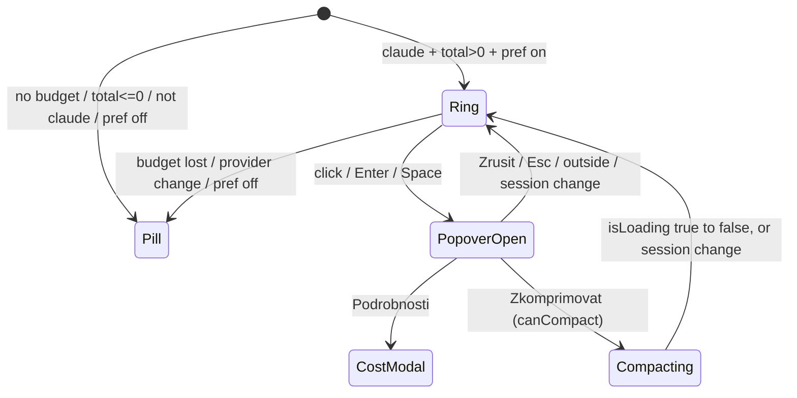

# Context Ring UI (Lane B) - Plan

## Goal Capsule

- **Objective:** A Brain Chat user talking to Claude can see at a glance how full the conversation's context window is, and can free space with one confirmed click, without losing what they were typing.
- **Means:** a fork-only `ContextUsageRing` button in the composer toolbar that takes the place of the token pill for Claude sessions and sends `/compact` through a dedicated send path (KTD1, KTD3).
- **Authority:** the coordinator's Lane B brief (owner-approved feature) > this plan > repo conventions (`.agents/skills/frontend-module-standards/SKILL.md`). The Lane A/Lane B contract in the brief is fixed; a change to it goes to the coordinator via `orca orchestration ask`.
- **Stop conditions:** stop and ask if the work needs an edit to `server/**`, `src/modules/chat/hooks/useChatRealtimeHandlers.ts`, `src/modules/chat/hooks/useChatSessionState.ts`, `src/shared/api.ts` token types, transcript rendering, or a new npm dependency.
- **Execution profile:** test-first for the ring maths, the send path and the preference; component tests for the popover; browser QA last.
- **Finishes and ships:** this worker opens a PR into `feat/context-ring`; the coordinator merges.

---

## Product Contract

### Summary

Add a small ring to the composer toolbar that fills green, amber, then red as the context window fills. For Claude sessions with a known window it replaces the "12.3K tokens" pill. Clicking it opens a short confirmation; confirming sends `/compact` and the ring pulses until the turn ends. The draft and attachments stay where they are. A preference lets the user hide the ring and get the pill back.

### Problem Frame

Users of long Claude sessions hit auto-compaction without warning, or never learn that `/compact` exists. The current pill shows a raw token count with no sense of how close the limit is. The Claude Code VS Code extension solved this with a context ring, but it snaps to coarse steps, uses a single colour, sends `/compact` without confirmation, and has sent attached images along with it (#95851, #75216). Upstream CloudCLI removed its own percentage pie (#807), so this stays a fork-only overlay, structured like the voice overlay.

### Requirements

**Display**

- R1. The ring is a ~20px SVG with a low-opacity full-circle track and a continuous arc proportional to `pct` (no snapping).
- R2. `pct = used / (autoCompactLimit ?? total) × 100`, clamped to 0–100. `autoCompactLimit` counts only when it is a finite number > 0.
- R3. Colour: green below 60, amber from 60, red from 85, judged on the same rounded integer the label shows. Classes work in light and dark themes.
- R4. The ring renders only when all hold: provider is `claude`, `tokenBudget` exists, `total` is a finite number > 0, and the `showContextRing` preference is on. Otherwise the existing `TokenUsageSummary` pill renders exactly as today. A `null` budget after a manual compact (Lane A may send one until the next reading) therefore hides the ring; it never shows 0%.
- R5. `aria-label`: "N % kontextu využito — kliknutím zkomprimujete" (cs) / "N% context used — click to compact" (en). The tooltip shows used against the same denominator the arc uses, in K (used/limit when `autoCompactLimit` exists, plus the full window on its own line; used/total otherwise), and "% remaining until auto-compact" when `autoCompactLimit` exists, "% remaining" otherwise. The popover repeats the usage line, so touch users get the number too. Colour is never the only signal.
- R6. The ring is a real button: keyboard-focusable with a visible focus ring, h-8 like its neighbours, and it fits the mobile toolbar at 360px without horizontal overflow.

**Compact action**

- R7. Clicking the ring opens an anchored confirmation (role `dialog`, labelled by its title and described by its body and any blocked reason) with: the usage line, "Zkomprimovat konverzaci? Claude shrne dosavadní průběh, aby uvolnil místo v kontextu.", a primary Zkomprimovat button, a Zrušit button, and a secondary "Podrobnosti" link that opens the existing `/cost` modal.
- R8. Confirming sends exactly one websocket `chat.send` with `content: '/compact'`, `attachments: []` and the normal send options, to the active session.
- R9. The draft text, pending attachments, edit state and queued message are never read or modified by the compact action.
- R10. Zkomprimovat is disabled, with the reason shown as visible text inside the popover, when any of: a turn is running, there is no active session, the session has no messages yet, the websocket is disconnected, a sent message is being edited, or a queued message is waiting.
- R11. From confirm until the turn ends, the ring shows a compacting state (pulse, `aria-busy`, label "Komprimuji konverzaci…"). It ends when the turn ends even if the budget became `null` meanwhile (the ring is then hidden until the next reading), and it clears when the session changes. The pulse respects `prefers-reduced-motion`.
- R12. The popover closes on Zkomprimovat, Zrušit, Escape, outside click, session change, or when the ring stops rendering. Escape never aborts a running turn. On open, focus lands on Zrušit, so a second Enter never compacts; on close it returns to the ring. Opening it while compacting shows Zkomprimovat disabled with the busy reason.

**Preference and copy**

- R13. `showContextRing: boolean`, default `true`, lives in `uiPreferences` and syncs like the other preferences. A toggle sits in Quick Settings.
- R14. All new strings live in a new `contextRing` i18n namespace with `en` and `cs` bundles; shared locale files are untouched.

### Key Decisions

- **The ring replaces the token pill when it renders, rather than sitting beside it.** Two usage indicators side by side repeat the same number and cost ~60px the mobile toolbar does not have. The `/cost` breakdown stays one click away through the popover's Podrobnosti link, and the pill returns wherever the ring cannot render (Codex, Cursor, OpenCode, no budget, preference off). Governs R4, R7.
- **Always visible when data exists, not only above 50% like VS Code.** Features hidden until a threshold go unfound (the voice-mic lesson); users who dislike it switch it off. Governs R4, R13.
- **Disable during a running turn instead of queueing.** The queue path clears the draft and is dispatched server-side; a queued `/compact` landing after a reply the user has not read yet would surprise them. A disabled button with a visible reason is predictable. Governs R10.
- **Claude only.** `/compact` reaches the Claude Agent SDK verbatim and compacts. Codex (`codex exec`), Cursor (`cursor-agent -p`) and OpenCode (`opencode run`) receive it as plain text the model would just read. Governs R4.

### Scope Boundaries

- Not built: a mid-turn queued compact (see Key Decisions).
- Not built: hiding the ring for `[1m]` models. Lane A guarantees `total` is the real per-model window; adding a client heuristic would mask a Lane A regression. Evidence that would change this: Lane A ships without that guarantee.
- Not built: a "waiting for fresh numbers" state after compaction. Lane A guarantees a fresh `token_budget` after a `/compact` turn; the ring shows whatever arrives.
- Not built: Codex compaction through `codex app-server` `thread/compact/start` (different transport, unverified parameters).
- Not built: a Settings-dialog toggle in addition to Quick Settings. One switch is enough to find; the voice overlay's double placement came from a separate settings tab that already existed.
- Outside this lane: server usage maths, `compact_boundary` transcript rows, `/cost` modal content.

---

## Planning Contract

### Key Technical Decisions

- KTD1. **Fork-overlay files live under `src/modules/chat/composer/`.** `ContextUsageRing.tsx`, `ContextRingSetting.tsx`, `contextRingI18n.ts` and `locales/{en,cs}/contextRing.json` sit in the composer directory Lane B owns, following the voice overlay's self-registering namespace (`src/modules/chat/voice/voiceI18n.ts`). Tests go in `src/modules/chat/tests/`.
- KTD2. **The ring decides its own visibility; ChatComposer only swaps the slot.** A pure helper in `ContextUsageRing.tsx` reads `used`, `total`, `autoCompactLimit` with the `readUsageNumber` finite guard from `TokenUsageSummary.tsx` and returns `null` when R4 fails. ChatComposer renders the ring when the helper yields a value and the pill otherwise. With `tokenBudget: null` the composer DOM is unchanged, so `src/modules/chat/voice/tests/__snapshots__/voice-off.baseline.html` stays green.
- KTD3. **`onCompact` is a dedicated send in `useChatComposerState.ts`, not a call to `handleSubmit`.** `handleSubmit` queues while loading, switches to `chat.edit-send` while editing and always clears the draft (`useChatComposerState.ts:648-719`, `:864`, `:879-893`). `onCompact` copies only the send block: guard (session id, project, not loading), `beforeUserSend()`, `addMessage` echo of `/compact` (same as typing it), `onSessionProcessing(sessionId, {statusText: null, canInterrupt: true})`, then `sendMessage({type: 'chat.send', sessionId, content: '/compact', options: {...buildSendOptions('/compact'), attachments: []}})`. It skips `recordSentMessage` (no ↑-history entry) and `noteOwnPromptSent` (nothing to read aloud).
- KTD4. **Compacting state is local to the hook.** A `compactPending` state is set by `onCompact` and cleared on the `isLoading` true→false edge (tracked with a ref of the previous value) or on `sessionKey` change. Exposed as `isCompacting`.
- KTD5. **Availability is computed in the hook from what it already has, plus two inputs from ChatInterface.** The hook knows `provider`, `sessionKey`, `isLoading`, `editingAnchorId` and `queuedDraft`. ChatInterface adds `hasMessages` (`chatMessages.length > 0`) and `isConnected` (from `useWebSocket()`), both optional hook args. The hook returns `compactAvailability: {canCompact, blockedReason}`, where `blockedReason` is one of `'busy' | 'noSession' | 'noMessages' | 'offline' | 'editing' | 'queued' | null`. ChatInterface passes `provider`, `compactAvailability`, `onCompact` and `isCompacting` to ChatComposer as optional props. ChatInterface is touched only to wire these.
- KTD6. **The popover uses `useComposerMenuAnchor` with a new left-aligned mode.** The hook right-aligns and floors width at 200px, so a left-group trigger overflows the left edge on phones. Add an `align: 'start' | 'end'` option (default `'end'`, existing callers unchanged) that anchors with `left = clamp(rect.left)` and `maxWidth = innerWidth - left - margin`. `ComposerMenuAnchor` in `src/shared/types.ts` gains an optional `left` and makes `right` optional. The surface is a plain `div role="dialog"` with the `ComposerMenuSurface` classes, because that component hardcodes `role="menu"`. The hook's Escape handler already calls `preventDefault`, which keeps the turn alive (`ChatInterface.tsx:296-314`).
- KTD7. **Colours are Tailwind palette classes on `currentColor`.** Arc: `text-emerald-500 dark:text-emerald-400`, `text-amber-500 dark:text-amber-400`, `text-red-500 dark:text-red-400`. Track: `currentColor` at opacity 0.2 on a `text-muted-foreground` circle. There are no success/warning theme tokens, and the composer already uses this palette (`ChatComposer.tsx:329`, `ComposerPermissionMenu.tsx:47`). Thresholds are `UPPER_SNAKE` constants in `ContextUsageRing.tsx`.
- KTD8. **The preference toggle is a self-contained `ContextRingSetting` exported through `src/modules/chat/index.ts`**, modelled on `src/modules/chat/voice/AutoSpeakSetting.tsx` (`variant: 'quick'`), dropped into `QuickSettingsContent.tsx` with one line. The generic toggle rows would require widening `PreferenceToggleKey` and editing shared `settings.json` locales the Czech overlay patches.

### High-Level Technical Design



```mermaid
flowchart TB
  CI[ChatInterface] -->|hasMessages, isConnected| H[useChatComposerState]
  H -->|onCompact, isCompacting, compactAvailability| CI
  CI -->|optional props| CC[ChatComposer toolbar slot]
  CC -->|ring visible| R[ContextUsageRing + popover]
  CC -->|ring hidden| P[TokenUsageSummary pill]
  R -->|confirm| H
  R -->|Podrobnosti| COST[showCostModal]
  H -->|chat.send /compact, attachments []| WS[websocket]
```

### Assumptions

- Lane A lands its contract: real per-model `total`, optional `autoCompactLimit`, a fresh `token_budget` after a `/compact` turn. Until it merges, the ring on a 1M model past 160K shows 100% red.
- Echoing `/compact` into the transcript matches what typing it does today. Browser QA with a live Claude session confirms there is no duplicate bubble; if there is, drop the echo.
- The coordinator accepts the small wiring edit in `src/modules/chat/ChatInterface.tsx`, `src/modules/chat/hooks/useComposerMenuAnchor.ts` and `src/shared/types.ts` (`ComposerMenuAnchor`), none of which Lane A owns.

---

## Implementation Units

### U1. `showContextRing` preference

- **Goal:** the preference exists, defaults to true and survives the reducer and parser.
- **Requirements:** R13.
- **Dependencies:** none.
- **Files:** `src/shared/uiPreferences.ts`, `src/shared/tests/uiPreferencesContextRing.test.ts`.
- **Approach:** add the key with a doc comment to `UiPreferences` and `DEFAULTS` (`true`). `parsePreference` already treats it as a boolean.
- **Patterns to follow:** `autoSpeak` entry; `src/shared/tests/uiPreferences.test.ts`.
- **Execution note:** test-first.
- **Test scenarios:**
  - An empty stored blob parses to `showContextRing: true`.
  - A stored `false` and a stored `'false'` both parse to `false`.
  - A garbage value (`42`) falls back to `true`.
  - `set` with `false` returns a new state with the key off; `set` with the same value returns the same object.
- **Verification:** the new test passes and the existing `uiPreferences.test.ts` still passes.

### U2. `contextRing` i18n namespace

- **Goal:** en and cs strings registered from the overlay's own module.
- **Requirements:** R5, R7, R10, R11, R14.
- **Dependencies:** none.
- **Files:** `src/modules/chat/composer/contextRingI18n.ts`, `src/modules/chat/composer/locales/en/contextRing.json`, `src/modules/chat/composer/locales/cs/contextRing.json`, `src/modules/chat/tests/contextRingLocales.test.ts`.
- **Approach:** copy `voiceI18n.ts`: export `CONTEXT_RING_NS = 'contextRing'`, add both bundles once, guarded by `hasResourceBundle`. Keys are two-segment (`ring.ariaLabel`, `ring.tooltipUsed`, `ring.compacting`, `confirm.title`, `confirm.body`, `confirm.compact`, `confirm.cancel`, `confirm.details`, `blocked.busy`, … , `setting.label`, `setting.description`) with i18next interpolation for numbers.
- **Patterns to follow:** `src/modules/chat/voice/voiceI18n.ts`, `src/modules/chat/voice/tests/voiceLocales.test.ts`.
- **Test scenarios:**
  - en and cs have identical key sets and no empty values.
  - Every `t('a.b')` key used in the overlay source files exists in en.
  - The cs copy differs from en for every key.
- **Verification:** locale test passes.

### U3. `ContextUsageRing` component and popover

- **Goal:** the ring renders per R1–R6 and the popover per R7, R10–R12.
- **Requirements:** R1–R7, R10–R12.
- **Dependencies:** U2, U6.
- **Files:** `src/modules/chat/composer/ContextUsageRing.tsx`, `src/modules/chat/tests/contextUsageRing.test.tsx`.
- **Approach:**
  1. Export a pure `readContextUsage(tokenBudget)` returning `{used, limit, total, pct, hasAutoCompactLimit} | null` (R2, R4 data part).
  2. Render an SVG circle pair (track + arc via `strokeDasharray`/`strokeDashoffset`, rotated −90°) inside a ghost icon button with the R5 label and a `Tooltip`.
  3. Popover via `useComposerMenuAnchor(isOpen, close, 288, 'start')` and `createPortal`; focus Zrušit on open; `aria-labelledby`/`aria-describedby` on the dialog; render the `blockedReason` text when present; close after Zkomprimovat.
  4. Close the popover when `sessionKey` changes or the component unmounts.
- **Patterns to follow:** `src/modules/chat/composer/ScheduleMessagePopover.tsx`, `src/modules/chat/composer/ComposerMenuPrimitives.tsx`, `src/modules/chat/composer/TokenUsageSummary.tsx`.
- **Execution note:** write the threshold and clamping tests against `readContextUsage` and the rendered classes first.
- **Test scenarios:**
  - 59% renders the green class; 60% amber; 84% amber; 85% red.
  - 59.6% rounds to 60 and renders amber (colour follows the shown number).
  - `used > total` clamps to 100 and the arc is full.
  - `autoCompactLimit: 100000, total: 200000, used: 50000` shows 50%, and the tooltip carries the "remaining until auto-compact" line.
  - `total: 0`, missing `total` and `tokenBudget: null` each make `readContextUsage` return null.
  - aria-label for 42% in cs reads "42 % kontextu využito — kliknutím zkomprimujete".
  - Click opens the dialog; Zrušit closes it, calls nothing, and returns focus to the ring.
  - Escape closes the dialog and the event is default-prevented.
  - Zkomprimovat calls `onCompact` once and closes the dialog.
  - Opening the dialog focuses Zrušit; pressing Enter immediately does not call `onCompact`.
  - The dialog is found by `getByRole('dialog', {name: 'Zkomprimovat konverzaci?'})`.
  - With `autoCompactLimit` the tooltip's used line shows used/limit in K and the window on a separate line.
  - With `blockedReason: 'busy'` the button is disabled and the reason text is visible.
  - With `isCompacting` the ring has `aria-busy="true"` and the compacting label.
  - Podrobnosti calls `onShowTokenUsage` and closes the dialog.
- **Verification:** component tests pass; the ring has no layout effect when not rendered.

### U4. `onCompact`, `isCompacting` and availability in `useChatComposerState`

- **Goal:** a send path that delivers exactly `/compact` and never touches the draft.
- **Requirements:** R8–R11.
- **Dependencies:** none.
- **Files:** `src/modules/chat/hooks/useChatComposerState.ts`, `src/modules/chat/tests/composerCompact.test.tsx`.
- **Approach:** per KTD3, KTD4, KTD5. New optional args `hasMessages`, `isConnected`; new returns `onCompact`, `isCompacting`, `compactAvailability`. Precedence of `blockedReason`: noSession, noMessages, offline, busy, editing, queued.
- **Patterns to follow:** `src/modules/chat/voice/tests/composerState.test.tsx` (renderHook with mocked `@/shared/api`), `showCostModal` at `useChatComposerState.ts:454-465`.
- **Execution note:** test-first; the "draft preserved" scenario is the core regression guard.
- **Test scenarios:**
  - With draft "rozepsaný text" and one attached file, `onCompact()` calls `sendMessage` exactly once with `{type: 'chat.send', content: '/compact', options.attachments: []}`; afterwards `input` and `attachedFiles` are unchanged and `readDraftText(scope)` still returns the draft.
  - `onCompact()` while `isLoading` sends nothing.
  - `onCompact()` with no session id sends nothing; availability reports `noSession`.
  - `hasMessages: false` reports `noMessages`; `isConnected: false` reports `offline`; a queued draft reports `queued`.
  - After `onCompact()`, `isCompacting` is true; rerender with `isLoading: true` then `false` makes it false.
  - Changing the session clears `isCompacting`.
  - After `onCompact()`, `tokenBudget` becomes `null` while loading, then `isLoading` goes false: `isCompacting` is false (pinned for Lane A's null-after-compact behaviour).
- **Verification:** hook tests pass; existing composer hook tests still pass.

### U5. Toolbar slot and ChatInterface wiring

- **Goal:** the composer shows ring or pill per R4 and passes the compact props through.
- **Requirements:** R4, R6.
- **Dependencies:** U3, U4.
- **Files:** `src/modules/chat/composer/ChatComposer.tsx`, `src/modules/chat/ChatInterface.tsx`, `src/modules/chat/tests/contextUsageRingComposer.test.tsx`.
- **Approach:** new optional props `provider`, `onCompact`, `isCompacting`, `compactAvailability`, `sessionKey`. At the pill's slot (`ChatComposer.tsx:495`) render the ring when `provider === 'claude'`, `showContextRing` is on and `readContextUsage(tokenBudget)` is non-null; otherwise the pill. ChatInterface reads `isConnected` from `useWebSocket()`, passes `hasMessages`/`isConnected` into the hook and the new props into ChatComposer.
- **Patterns to follow:** `src/modules/chat/voice/tests/composerFixture.tsx`.
- **Test scenarios:**
  - Claude + budget `{used: 50000, total: 160000}` renders the ring and no pill.
  - Same budget with `showContextRing: false` renders the pill and no ring.
  - Provider `codex` with a budget renders the pill.
  - `tokenBudget: null` renders the pill; the voice-off snapshot stays identical.
  - Ring visible and compacting, then the budget turns `null` and `isCompacting` turns false: the ring is gone and the pill shows, with no 0% ring.
  - Integration: click ring → Zkomprimovat with a draft typed in the composer calls `onCompact` once and the textarea still holds the draft.
- **Verification:** composer tests pass; `voiceOffInvariance.test.tsx` passes unchanged.

### U6. Left-aligned popover anchor

- **Goal:** composer popovers triggered from the left toolbar group stay on screen.
- **Requirements:** R6, R12.
- **Dependencies:** none.
- **Files:** `src/modules/chat/hooks/useComposerMenuAnchor.ts`, `src/shared/types.ts`, `src/modules/chat/composer/ComposerMenuPrimitives.tsx` (only if the surface must accept `left`), `src/modules/chat/tests/composerMenuAnchor.test.tsx`.
- **Approach:** per KTD6. Default behaviour for existing callers is byte-for-byte the same anchor object.
- **Test scenarios:**
  - `align: 'start'` with a trigger at `left: 16` on a 375px viewport yields `left: 16` and `maxWidth ≤ 351`.
  - A trigger at `left: 2` clamps to the 8px margin.
  - Default alignment returns the same `right`/`bottom` values as before.
- **Verification:** anchor tests pass; Schedule, Model and Permission menus look unchanged in QA.

### U7. Quick Settings toggle

- **Goal:** the user can switch the ring off and on.
- **Requirements:** R13.
- **Dependencies:** U1, U2.
- **Files:** `src/modules/chat/composer/ContextRingSetting.tsx`, `src/modules/chat/index.ts`, `src/modules/quick-settings-panel/QuickSettingsContent.tsx`, `src/modules/chat/tests/contextRingSetting.test.tsx`.
- **Approach:** per KTD8; always visible, unlike the voice-gated rows.
- **Patterns to follow:** `src/modules/chat/voice/AutoSpeakSetting.tsx`, `src/modules/chat/voice/tests/autoSpeakSetting.test.tsx`.
- **Test scenarios:**
  - Renders checked by default.
  - Clicking it sets `showContextRing` to false; clicking again sets it back.
- **Verification:** test passes; the toggle appears in the Quick Settings panel in QA.

### U8. Docs and overlay notes

- **Goal:** the fork's docs say the ring exists, how to turn it off, and why it is fork-only.
- **Requirements:** none directly; supports maintenance.
- **Dependencies:** U1–U7.
- **Files:** `CHANGELOG.md` (fork section, if the voice overlay used one) or the overlay notes the voice overlay updated; `docs/plans/2026-10-16-context-ring-ui-report.md`.
- **Test expectation:** none -- documentation only.
- **Verification:** docs read correctly and point at the right files.

---

## Verification Contract

| Gate | Command | Applies to |
|---|---|---|
| Focused tests | `npx vitest run src/modules/chat/tests/contextUsageRing.test.tsx src/modules/chat/tests/composerCompact.test.tsx src/modules/chat/tests/contextRingLocales.test.ts src/modules/chat/tests/contextUsageRingComposer.test.tsx src/modules/chat/tests/composerMenuAnchor.test.tsx src/modules/chat/tests/contextRingSetting.test.tsx src/shared/tests/uiPreferencesContextRing.test.ts` | U1–U7 |
| Voice overlay invariance | `npx vitest run src/modules/chat/voice` | U5, U6 |
| Client suite | `npm run test:client` | all |
| Server suite | `npm test` | regression only (no server edits) |
| Types | `npm run typecheck` | all |
| Lint | `npm run lint` | all |
| Build | `npm run build:client` | all |
| Browser QA | gstack `/browse` against `npm run dev`: light and dark, desktop and 360px, low/mid/high usage, confirm dialog | U3, U5, U6, U7 |
| Live compaction (required) | one real ring → Zkomprimovat against a Claude session: the turn runs as a compaction (not a model reply to the text "/compact"), the transcript shows no duplicate `/compact` bubble, the ring ends lower or hidden | R8, KTD3 |

If no Claude session can be run locally, ask the coordinator through `orca orchestration ask` before opening the PR rather than skipping the live check.

Any failure that already exists on `feat/context-ring` is proven by running the same command there.

## Definition of Done

- Every R-ID is covered by a passing test or a QA screenshot.
- The live compaction check ran, or the coordinator explicitly waived it.
- All gates in the Verification Contract are green, or a pre-existing failure is shown on the base branch.
- No edits to `server/**`, `useChatRealtimeHandlers.ts`, `useChatSessionState.ts`, or shared `chat.json`/`settings.json` locales; no new dependencies.
- No abandoned-attempt code left in the diff.
- Commits are small conventional commits authored as Miroslav Michalko <michalko@umelainteligence.cz>, without `Co-authored-by` trailers.
- PR open into `feat/context-ring`, not merged.

---

## Appendix

### Sources

- Token budget shape and missing `total`: `server/modules/providers/list/claude/claude-runtime.provider.js:434-438`, `server/modules/providers/services/provider-token-usage.service.ts:372-393`.
- Provider handling of `/compact`: `server/modules/websocket/services/chat-websocket.service.ts` passes `data.content` through unchanged; only the Claude Agent SDK runs it as a command.
- Send path: `src/modules/chat/hooks/useChatComposerState.ts:595-622` (`buildSendOptions`), `:624-916` (`handleSubmit`).
- Escape aborts a turn unless default-prevented: `src/modules/chat/ChatInterface.tsx:296-314`.
- Connection state: `src/shared/context/WebSocketContext.tsx` (`isConnected`).
- Composer DOM snapshot: `src/modules/chat/voice/tests/voiceOffInvariance.test.tsx`.
