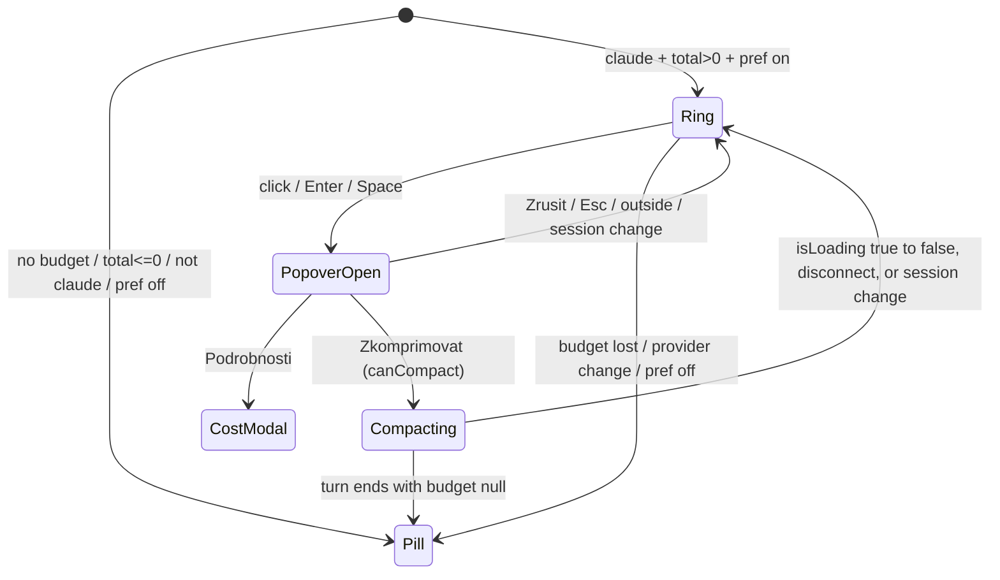
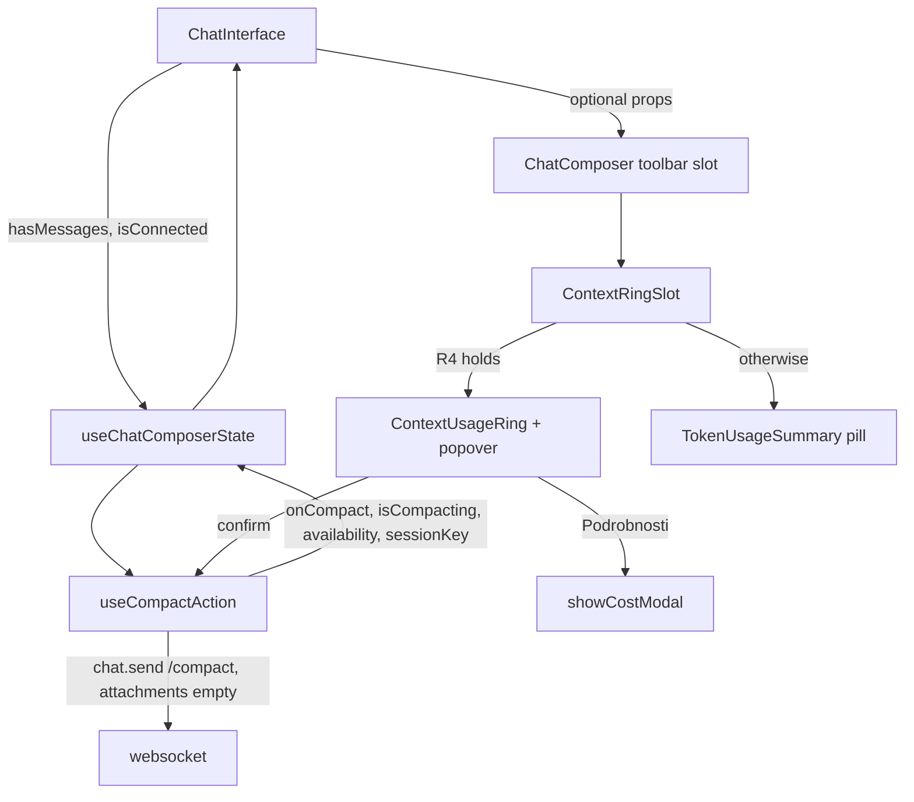

# Context Ring UI (Lane B) - Plan

## Goal Capsule

- **Objective:** A Brain Chat user talking to Claude can see at a glance how full the conversation's context window is, and can free space with one confirmed click, without losing what they were typing.
- **Means:** a fork-only `ContextUsageRing` button in the composer toolbar that takes the place of the token pill for Claude sessions and sends `/compact` through a dedicated send path (KTD1, KTD3).
- **Authority:** the coordinator's Lane B brief (owner-approved feature) > this plan > repo conventions (`.agents/skills/frontend-module-standards/SKILL.md`). The Lane A/Lane B contract in the brief is fixed; a change to it goes to the coordinator via `orca orchestration ask`.
- **Stop conditions:** stop and ask if the work needs an edit to `server/**`, `src/modules/chat/hooks/useChatRealtimeHandlers.ts`, `src/modules/chat/hooks/useChatSessionState.ts`, `src/shared/api.ts` token types, transcript rendering, or a new npm dependency.
- **Execution profile:** test-first for the ring maths, the send path and the preference; component tests for the popover; browser QA last.
- **Finishes and ships:** this worker opens a PR into `feat/context-ring`; the coordinator merges.

---

## Product Contract

### Summary

Add a small ring to the composer toolbar that fills green, amber, then red as the context window fills. For Claude sessions with a known window it replaces the "12.3K tokens" pill. Clicking it opens a short confirmation; confirming sends `/compact` and the ring pulses until the turn ends. The draft and attachments stay where they are. A preference lets the user hide the ring and get the pill back.

### Problem Frame

Users of long Claude sessions hit auto-compaction without warning, or never learn that `/compact` exists. The current pill shows a raw token count with no sense of how close the limit is. The Claude Code VS Code extension solved this with a context ring, but it snaps to coarse steps, uses a single colour, sends `/compact` without confirmation, and has sent attached images along with it (#95851, #75216). Upstream CloudCLI removed its own percentage pie (#807), so this stays a fork-only overlay, structured like the voice overlay.

### Requirements

**Display**

- R1. The ring is a ~20px SVG with a low-opacity full-circle track and a continuous arc proportional to `pct` (no snapping).
- R2. `pct = used / (autoCompactLimit ?? total) × 100`, clamped to 0–100. `autoCompactLimit` counts only when it is a finite number > 0.
- R3. Colour: green below 60, amber from 60, red from 85, judged on the same rounded integer the label shows. Classes work in light and dark themes.
- R4. The ring renders only when all hold: provider is `claude`, `tokenBudget` exists, `total` is a finite number > 0, and the `showContextRing` preference is on. Otherwise the existing `TokenUsageSummary` pill renders exactly as today. A `null` budget after a manual compact (Lane A may send one until the next reading) therefore hides the ring; it never shows 0%.
- R5. `aria-label`: "N % kontextu využito — kliknutím zkomprimujete" (cs) / "N% context used — click to compact" (en). The tooltip shows used against the same denominator the arc uses, in K (used/limit when `autoCompactLimit` exists, plus the full window on its own line; used/total otherwise), and "% remaining until auto-compact" when `autoCompactLimit` exists, "% remaining" otherwise. The popover repeats the usage and remaining lines, so touch and keyboard users get the numbers too (the shared tooltip opens only on hover or long-press). Colour is never the only signal.
- R6. The ring is a real button: keyboard-focusable with a visible focus ring, h-8 like its neighbours, and it fits the mobile toolbar at 360px without horizontal overflow.

**Compact action**

- R7. Clicking the ring opens an anchored confirmation (role `dialog`, labelled by its title and described by its body and any blocked reason) with: the usage line, "Zkomprimovat konverzaci? Claude shrne dosavadní průběh, aby uvolnil místo v kontextu.", a primary Zkomprimovat button, a Zrušit button, and a secondary "Podrobnosti" link that opens the existing `/cost` modal.
- R8. Confirming sends exactly one websocket `chat.send` with `content: '/compact'`, `attachments: []` and the normal send options, to the active session.
- R9. The compact action never modifies the draft text, pending attachments, edit state or queued message (R10 only reads the last two to decide availability).
- R10. Zkomprimovat is disabled, with the reason shown as visible text inside the popover, when any of: a turn is running, there is no active session, the session has no messages yet, the websocket is disconnected, a sent message is being edited, or a queued message is waiting.
- R11. From confirm until the turn ends, the ring shows a compacting state (pulse, `aria-busy`, label "Komprimuji konverzaci…"). It ends when the turn ends even if the budget became `null` meanwhile (the ring is then hidden until the next reading), and it clears when the session changes or the websocket disconnects. Start and end are announced through a polite status region. The pulse respects `prefers-reduced-motion`.
- R12. The popover closes on Zkomprimovat, Zrušit, Podrobnosti, Escape, outside click, session change, or when the ring stops rendering. Escape never aborts a running turn. On open, focus lands on Zrušit, so a second Enter never compacts; after Escape, Zrušit or Zkomprimovat it returns to the ring (an outside click leaves focus where the user clicked). Opening it while compacting shows Zkomprimovat disabled with the busy reason.

**Preference and copy**

- R13. `showContextRing: boolean`, default `true`, lives in `uiPreferences` and syncs like the other preferences. A toggle sits in Quick Settings.
- R14. All new strings live in a new `contextRing` i18n namespace with `en` and `cs` bundles; shared locale files are untouched.

### Key Decisions

- **The ring replaces the token pill when it renders, rather than sitting beside it.** Two usage indicators side by side repeat the same number and cost ~60px the mobile toolbar does not have. The `/cost` breakdown stays one click away through the popover's Podrobnosti link, and the pill returns wherever the ring cannot render (Codex, Cursor, OpenCode, no budget, preference off). Governs R4, R7.
- **Always visible when data exists, not only above 50% like VS Code.** Features hidden until a threshold go unfound (the voice-mic lesson); users who dislike it switch it off. Governs R4, R13.
- **Disable during a running turn instead of queueing.** The queue path clears the draft and is dispatched server-side; a queued `/compact` landing after a reply the user has not read yet would surprise them. A disabled button with a visible reason is predictable. Governs R10.
- **Claude only.** `/compact` reaches the Claude Agent SDK verbatim and compacts. Codex (`codex exec`), Cursor (`cursor-agent -p`) and OpenCode (`opencode run`) receive it as plain text the model would just read. Governs R4.

### Scope Boundaries

- Not built: a mid-turn queued compact (see Key Decisions).
- Not built: hiding the ring for `[1m]` models. Lane A guarantees `total` is the real per-model window; adding a client heuristic would mask a Lane A regression. Evidence that would change this: Lane A ships without that guarantee.
- Not built: a "waiting for fresh numbers" state after compaction. Lane A guarantees a fresh `token_budget` after a `/compact` turn; the ring shows whatever arrives.
- Not built: Codex compaction through `codex app-server` `thread/compact/start` (different transport, unverified parameters).
- Not built: a Settings-dialog toggle in addition to Quick Settings. One switch is enough to find; the voice overlay's double placement came from a separate settings tab that already existed.
- Not built: a post-compact cooldown. The coordinator confirmed Lane A sends either `null` or a fresh budget after a manual compact, so a stale red ring is a Lane A defect, not a UI state.
- Not built: collapsing the editing and queued blocks into one generic reason. Both guard real races: finishing an edit after a compact rewinds the conversation, and a queued message races the compact run (`RUN_IN_PROGRESS`).
- Accepted: the ring always sends the SDK's `/compact`, bypassing a user's custom `.claude/commands/compact.md` that typing `/compact` would trigger. The compacting state is per tab; a second tab sees an ordinary running turn.
- Outside this lane: server usage maths, `compact_boundary` transcript rows, `/cost` modal content.

---

## Planning Contract

### Key Technical Decisions

- KTD1. **Fork-overlay files live under `src/modules/chat/composer/` plus one new hook.** `ContextUsageRing.tsx` (ring, popover and `ContextRingSlot`), `ContextRingSetting.tsx`, `contextRingI18n.ts` and `locales/{en,cs}/contextRing.json` sit in the composer directory Lane B owns, following the voice overlay's self-registering namespace (`src/modules/chat/voice/voiceI18n.ts`). The send logic lives in a new fork-owned `src/modules/chat/hooks/useCompactAction.ts`. Tests go in `src/modules/chat/tests/` and may import the voice overlay's `composerFixture.tsx` rather than duplicating it.
- KTD2. **`ContextRingSlot` owns visibility; ChatComposer swaps one line.** The slot receives `provider`, `tokenBudget`, the compact props and the pill as `fallback`, reads `showContextRing` itself, and renders the ring only when R4 holds. A pure `readContextUsage(tokenBudget)` uses its own strict guard (`typeof value === 'number' && Number.isFinite(value)`); a missing `used` or `total` returns `null` and the pill shows. It does not reuse `TokenUsageSummary`'s private `readUsageNumber` or its `input + output` fallback. With `tokenBudget: null` the composer DOM is unchanged, so `src/modules/chat/voice/tests/__snapshots__/voice-off.baseline.html` stays green. The ring and slot are `memo`'d and receive primitives, because the composer re-renders on every keystroke.
- KTD3. **`useCompactAction` sends `/compact` on its own path, never through `handleSubmit`.** `handleSubmit` queues while loading, switches to `chat.edit-send` while editing and always clears the draft (`useChatComposerState.ts:648-719`, `:864`, `:879-893`). `onCompact` (a stable `useCallback`):
  1. returns unless `availability.canCompact`;
  2. calls `beforeUserSend()` and echoes `/compact` with `addMessage` (as typing it does);
  3. calls `onSessionProcessing(sessionId, {statusText: null, canInterrupt: true})` and `noteOwnPromptSent(sessionId)`, which keeps the voice overlay's authorship count symmetric with its `protocol_error` withdrawal and clears a stale voice note;
  4. sends `{type: 'chat.send', sessionId, content: '/compact', options: {...buildSendOptions(''), attachments: []}}`. The empty argument keeps a notification summary from ever reading "/compact".

  It skips `recordSentMessage`, so `/compact` stays out of the ↑ history. `useChatComposerState` calls the hook and spreads its result into its return value, keeping the upstream diff to a few lines.
- KTD4. **`isCompacting` is derived, so it cannot stick.** State `compactSessionKey: string | null` is set by `onCompact`. `isCompacting = compactSessionKey === sessionKey && isLoading`. An effect clears the key on the `isLoading` true→false edge (previous value in a ref), when `isConnected` turns false, and when the first commit after `onCompact` still shows `isLoading` false (the send never started, so a later ordinary turn cannot inherit the pulse). `onCompact` raises processing in the same event as it sets the key, so React batches both into that commit. A session switch makes the comparison false with no reset. A `protocol_error` (e.g. `RUN_IN_PROGRESS`) ends the processing state through the existing `onSessionIdle`, which is the same true→false edge.
- KTD5. **Availability is computed in `useCompactAction` from hook state plus two ChatInterface inputs.** Inputs: `sessionKey`, `isLoading`, `editingAnchorId`, `queuedDraft`, and the new optional `useChatComposerState` args `hasMessages` (`chatMessages.length > 0`) and `isConnected` (from `useWebSocket()`), both defaulting to `true` so existing callers and tests are unaffected. Output: a memoised `{canCompact, blockedReason}`. Precedence of `blockedReason`: `noSession`, `noMessages`, `offline`, `busy`, `editing`, `queued`. `CompactBlockedReason` and `CompactAvailability` live in `src/shared/types.ts` with doc comments, since four files use them. The hook also returns the session key it compacted, so the ring can close its popover on a session change. `hasMessages` may flicker false while a session's messages load; the popover then briefly shows the no-messages reason, which is accepted.
- KTD6. **The popover reuses `useComposerMenuAnchor` and `ComposerMenuSurface` with a left-aligned mode.** The hook right-aligns and floors width at 200px, so a left-group trigger overflows the left edge on phones.
  - `useComposerMenuAnchor(isOpen, onClose, preferredWidth, align = 'end')` gains a 4th positional argument. `'start'` returns `left = max(margin, rect.left)` and `maxWidth = min(preferredWidth, innerWidth - left - margin)` with no 200px floor. `'end'` keeps today's anchor object unchanged.
  - `ComposerMenuAnchor` in `src/shared/types.ts` becomes a discriminated union of `{right}` and `{left}` over the shared `bottom`, `maxHeight`, `maxWidth` fields, so existing callers keep full type safety.
  - `ComposerMenuSurface` gains an optional `role` prop (default `'menu'`) and applies `left` when the anchor carries it. The ring passes `role="dialog"`, `aria-modal="false"`, `aria-labelledby` and `aria-describedby`.
  - The hook's Escape handler already calls `preventDefault`, which keeps the turn alive (`ChatInterface.tsx:296-314`), and already refocuses the trigger. The ring refocuses it itself after Zrušit and Zkomprimovat. Zrušit takes `autoFocus`, because the portal mounts only once `anchor` is set.
- KTD7. **Colours are Tailwind palette classes on `currentColor`.** Arc: `text-emerald-500 dark:text-emerald-400`, `text-amber-500 dark:text-amber-400`, `text-red-500 dark:text-red-400`. Track: `currentColor` at opacity 0.2 on a `text-muted-foreground` circle. The SVG is `aria-hidden="true" focusable="false"`; the button carries the label. The pulse is `motion-safe:animate-pulse`. There are no success/warning theme tokens, and the composer already uses this palette (`ChatComposer.tsx:329`, `ComposerPermissionMenu.tsx:47`). Thresholds are `UPPER_SNAKE` constants in `ContextUsageRing.tsx`.
- KTD8. **The preference toggle is a self-contained `ContextRingSetting` exported through `src/modules/chat/index.ts`**, modelled on `src/modules/chat/voice/AutoSpeakSetting.tsx` (`variant: 'quick'`), placed in Quick Settings' input-settings section next to `<AutoSpeakSetting variant="quick" />`. The generic toggle rows would require widening `PreferenceToggleKey` and editing shared `settings.json` locales the Czech overlay patches.
- KTD9. **Tooltip text comes from a pure formatter.** `formatContextTooltip(usage, t)` returns the tooltip lines and is unit-tested directly; the popover renders the same lines. The ring renders `PromptInputButton` without its `tooltip` prop, wrapped in its own `Tooltip` whose `content` is always set and whose `className` is `hidden` while the popover is open. Clearing `content` instead would make the shared `Tooltip` swap its wrapper `div` for a fragment, remount the button and lose focus. Only one DOM hover test runs, under `vi.useFakeTimers()` (the shared tooltip waits 350ms).

### High-Level Technical Design

### Assumptions

- Lane A lands its contract: real per-model `total`, optional `autoCompactLimit`, and after a manual `/compact` either `null` or a fresh budget. Until it merges, a 1M model past 160K shows 100% red, and the ring-after part of the live check cannot pass.
- The early-warning goal needs Lane A to send `autoCompactLimit` for Claude sessions. Without it the ring measures against the full window and may turn red only after Claude has already auto-compacted.
- Echoing `/compact` into the transcript matches what typing it does today. U9 and the live check confirm there is no duplicate bubble, including after a reload. If there is one, the only allowed fix in this lane is dropping the echo; message reconciliation belongs elsewhere.
- The coordinator accepts small wiring edits in `src/modules/chat/ChatInterface.tsx`, `src/modules/chat/hooks/useComposerMenuAnchor.ts`, `src/modules/chat/composer/ComposerMenuPrimitives.tsx` and `src/shared/types.ts`, none of which Lane A owns.
- Commits follow the owner's rule: author Miroslav Michalko <michalko@umelainteligence.cz>, no `Co-authored-by` trailers, overriding any harness default.

### Sequencing

U9 first. Then U1, U2, U4 and U6 (independent). Then U3, U7 and U5. U8 last.

---

## Implementation Units

### U9. Live `/compact` spike

- **Goal:** prove, before building UI on it, that `/compact` sent through this fork's `chat.send` runs a real compaction and ends its turn.
- **Requirements:** R8, R11.
- **Dependencies:** none.
- **Files:** none committed; findings go into `docs/plans/2026-10-16-context-ring-ui-report.md` later.
- **Approach:** start `npm run dev` from the worktree on free ports, open a throwaway Claude session (compaction rewrites history), exchange two short messages, then type `/compact` and send. Observe whether the run ends (`complete` arrives, the spinner stops), what the transcript shows live and after a reload, and what `token_budget` arrives. Pass criterion: after the reload the transcript contains the compact-summary entry (`isCompactSummary`, emitted by `claude-sessions.provider.ts`). A plain assistant reply without it is a failure.
- **Execution note:** smoke check, no tests. If compaction does not run or the turn never ends, stop and escalate to the coordinator before U3 and U5.
- **Test expectation:** none -- runtime spike.
- **Verification:** a written observation of turn end, transcript shape and budget, with a screenshot.

### U1. `showContextRing` preference

- **Goal:** the preference exists, defaults to true and survives the reducer and parser.
- **Requirements:** R13.
- **Dependencies:** none.
- **Files:** `src/shared/uiPreferences.ts`, `src/shared/tests/uiPreferences.test.ts` (add `showContextRing: true` to the fresh-install defaults `deepEqual`), `src/shared/tests/uiPreferencesContextRing.test.ts`.
- **Approach:** add the key with a doc comment to `UiPreferences` and `DEFAULTS` (`true`). `parsePreference` already treats it as a boolean.
- **Patterns to follow:** `autoSpeak` entry; `src/shared/tests/uiPreferences.test.ts`.
- **Execution note:** test-first.
- **Test scenarios:**
  - An empty stored blob parses to `showContextRing: true`.
  - A stored `false` and a stored `'false'` both parse to `false`.
  - A garbage value (`42`) falls back to `true`.
  - `set` with `false` returns a new state with the key off; `set` with the same value returns the same object.
- **Verification:** the new test and the updated `uiPreferences.test.ts` pass.

### U2. `contextRing` i18n namespace

- **Goal:** en and cs strings registered from the overlay's own module.
- **Requirements:** R5, R7, R10, R11, R14.
- **Dependencies:** none.
- **Files:** `src/modules/chat/composer/contextRingI18n.ts`, `src/modules/chat/composer/locales/en/contextRing.json`, `src/modules/chat/composer/locales/cs/contextRing.json`, `src/modules/chat/tests/contextRingLocales.test.ts`.
- **Approach:** copy `voiceI18n.ts`: export `CONTEXT_RING_NS = 'contextRing'`, add both bundles once, guarded by `hasResourceBundle`. Keys are two-segment (`ring.ariaLabel`, `ring.compacting`, `usage.ofWindow`, `usage.remaining`, `confirm.title`, `confirm.body`, `confirm.compact`, `confirm.cancel`, `confirm.details`, `blocked.busy`, …, `status.started`, `status.finished`, `setting.label`, `setting.description`) with i18next interpolation for numbers.
- **Patterns to follow:** `src/modules/chat/voice/voiceI18n.ts`, `src/modules/chat/voice/tests/voiceLocales.test.ts`.
- **Test scenarios:**
  - en and cs have identical key sets and no empty values.
  - Every `t('a.b')` key used in the overlay source files exists in en.
  - The cs copy differs from en for every key except an explicit exempt list of format-only strings (e.g. `{{used}}K / {{limit}}K`).
- **Verification:** locale test passes.

### U4. `useCompactAction` and its wiring into `useChatComposerState`

- **Goal:** a send path that delivers exactly `/compact`, never touches the draft, and whose compacting state cannot stick.
- **Requirements:** R8–R11.
- **Dependencies:** none.
- **Files:** `src/modules/chat/hooks/useCompactAction.ts`, `src/modules/chat/hooks/useChatComposerState.ts`, `src/shared/types.ts` (`CompactBlockedReason`, `CompactAvailability`), `src/modules/chat/tests/composerCompact.test.tsx`.
- **Approach:** per KTD3, KTD4, KTD5. `useChatComposerState` gains the optional args `hasMessages` and `isConnected` and returns `onCompact`, `isCompacting`, `compactAvailability` and the compact session key from the new hook.
- **Patterns to follow:** `src/modules/chat/voice/tests/composerState.test.tsx` (renderHook with mocked `@/shared/api`, `installAudioFakes()` because `beforeUserSend` touches the voice player), `showCostModal` at `useChatComposerState.ts:454-465`.
- **Execution note:** test-first; the "draft preserved" scenario is the core regression guard.
- **Test scenarios:**
  - With draft "rozepsaný text" and one attached file, `onCompact()` calls `sendMessage` exactly once with `{type: 'chat.send', content: '/compact', options.attachments: []}`; afterwards `input` and `attachedFiles` are unchanged and `readDraftText(scope)` still returns the draft.
  - The sent `options.sessionSummary` is never `"/compact"` for a session without a summary.
  - `onCompact()` while `isLoading` sends nothing.
  - `onCompact()` with no session id sends nothing; availability reports `noSession`.
  - `hasMessages: false` reports `noMessages`; `isConnected: false` reports `offline` and `onCompact()` sends nothing; a queued draft reports `queued`; an active edit reports `editing`.
  - Omitting `hasMessages` and `isConnected` leaves availability at `canCompact: true` for an idle session.
  - After `onCompact()` and a rerender with `isLoading: true`, `isCompacting` is true; rerendering with `isLoading: false` makes it false.
  - After `onCompact()`, `tokenBudget` becomes `null` while loading, then `isLoading` goes false: `isCompacting` is false (pinned for Lane A's null-after-compact behaviour).
  - `isConnected` turning false during compaction makes `isCompacting` false.
  - Changing the session makes `isCompacting` false; switching back after the turn ended does not revive it.
  - A send whose `isLoading` never turns true never reports `isCompacting`, and a later ordinary turn in the same session (`isLoading` true) does not report it either.
  - After `onCompact()` raises processing, a `protocol_error`-driven idle (`isLoading` back to false) clears `isCompacting`.
- **Verification:** hook tests pass; existing composer hook tests (`composerState.test.tsx`, `composerDraftScoping.test.tsx`) still pass.

### U6. Left-aligned popover anchor

- **Goal:** composer popovers triggered from the left toolbar group stay on screen.
- **Requirements:** R6, R12.
- **Dependencies:** none.
- **Files:** `src/modules/chat/hooks/useComposerMenuAnchor.ts`, `src/shared/types.ts` (`ComposerMenuAnchor` union), `src/modules/chat/composer/ComposerMenuPrimitives.tsx` (`role` prop, `left` support), `src/modules/chat/tests/composerMenuAnchor.test.tsx`.
- **Approach:** per KTD6. Tests stub the trigger's `getBoundingClientRect` and set `window.innerWidth`/`innerHeight`, since jsdom returns zeros; the anchor is computed only while open.
- **Test scenarios:**
  - `align: 'start'` with a trigger at `left: 16` on a 375px viewport yields `left: 16` and `maxWidth` of at most 351.
  - A trigger at `left: 2` clamps to the 8px margin.
  - The default alignment returns the same `right`, `bottom`, `maxHeight` and `maxWidth` values as before.
  - `ComposerMenuSurface` without `role` still renders `role="menu"`; with `role="dialog"` and a left anchor it renders `left` in its style.
- **Verification:** anchor tests pass; Schedule, Model and Permission menus look unchanged in QA.

### U3. `ContextUsageRing`, popover and `ContextRingSlot`

- **Goal:** the ring renders per R1–R6, the popover per R7 and R10–R12, and the slot per R4.
- **Requirements:** R1–R7, R10–R12.
- **Dependencies:** U2, U4, U6.
- **Files:** `src/modules/chat/composer/ContextUsageRing.tsx`, `src/modules/chat/tests/contextUsageRing.test.tsx`.
- **Approach:**
  1. Export the pure `readContextUsage(tokenBudget)` returning `{used, limit, total, pct, hasAutoCompactLimit} | null` (KTD2) and `formatContextTooltip` (KTD9).
  2. Render an SVG track and arc (`strokeDasharray`/`strokeDashoffset`, rotated −90°) inside `PromptInputButton`, which already gives `type="button"`, ghost `h-8 w-8` and the focus ring; the tooltip wraps it per KTD9.
  3. Popover per KTD6 at `preferredWidth` 288 with `'start'` alignment; it shows the usage and remaining lines, the question, the body, the `blockedReason` text when present, Zkomprimovat, Zrušit (`autoFocus`) and Podrobnosti; it closes after Zkomprimovat.
  4. Close the popover when the session changes or the ring unmounts.
  5. `ContextRingSlot` applies R4 and renders the ring or the `fallback` pill.
  6. The `sr-only` `role="status"` region lives in `ContextRingSlot`, driven by the `isCompacting` edge, so the end announcement survives the ring unmounting when the budget turns `null`.
- **Patterns to follow:** `src/modules/chat/composer/ScheduleMessagePopover.tsx`, `src/modules/chat/composer/ComposerMenuPrimitives.tsx`, `src/modules/chat/composer/PromptInput.tsx` (`PromptInputButton`).
- **Execution note:** write the threshold, clamping and formatter tests first.
- **Test scenarios:**
  - 59% renders the green class; 60% amber; 84% amber; 85% red.
  - 59.6% rounds to 60 and renders amber (colour follows the shown number).
  - `used > total` clamps to 100 and the arc is full.
  - `autoCompactLimit: 100000, total: 200000, used: 50000` shows 50%; the formatter's used line reads used/limit in K, the window sits on its own line, and the "remaining until auto-compact" line is present.
  - `total: 0`, missing `total`, missing `used`, a string `used`, and `tokenBudget: null` each make `readContextUsage` return null.
  - aria-label for 42% in cs reads "42 % kontextu využito — kliknutím zkomprimujete".
  - Click opens the dialog, found by `getByRole('dialog', {name: 'Zkomprimovat konverzaci?'})`; Zrušit is focused.
  - Pressing Enter immediately after opening does not call `onCompact`.
  - Zrušit closes the dialog, calls nothing, and focus returns to the ring.
  - Escape closes the dialog, the event is default-prevented, and focus returns to the ring.
  - Zkomprimovat calls `onCompact` once, closes the dialog and focus returns to the ring.
  - Enter or Space on a dialog button never triggers the composer's submit.
  - With `blockedReason: 'busy'` the button is disabled and the reason text is visible and referenced by `aria-describedby`.
  - With `isCompacting` the ring has `aria-busy="true"`, the compacting label and the `motion-safe:animate-pulse` class, and the slot's status region announces the start.
  - Podrobnosti calls `onShowTokenUsage` and closes the dialog.
  - Hovering the ring (fake timers, 350ms) shows the tooltip; while the dialog is open the tooltip is not visible.
- **Verification:** component tests pass.

### U7. Quick Settings toggle

- **Goal:** the user can switch the ring off and on.
- **Requirements:** R13.
- **Dependencies:** U1, U2.
- **Files:** `src/modules/chat/composer/ContextRingSetting.tsx`, `src/modules/chat/index.ts`, `src/modules/quick-settings-panel/QuickSettingsContent.tsx`, `src/modules/chat/tests/contextRingSetting.test.tsx`.
- **Approach:** per KTD8; always visible, unlike the voice-gated rows.
- **Patterns to follow:** `src/modules/chat/voice/AutoSpeakSetting.tsx`, `src/modules/chat/voice/tests/autoSpeakSetting.test.tsx`.
- **Test scenarios:**
  - Renders checked by default.
  - Clicking it sets `showContextRing` to false; clicking again sets it back.
- **Verification:** test passes; the toggle appears in the Quick Settings panel in QA.

### U5. Toolbar slot and ChatInterface wiring

- **Goal:** the composer shows the ring or the pill per R4 and passes the compact props through.
- **Requirements:** R4, R6.
- **Dependencies:** U3, U4.
- **Files:** `src/modules/chat/composer/ChatComposer.tsx`, `src/modules/chat/ChatInterface.tsx`, `src/modules/chat/tests/contextUsageRingComposer.test.tsx`.
- **Approach:** new optional ChatComposer props `provider`, `onCompact`, `isCompacting`, `compactAvailability`, `compactSessionKey`. At `ChatComposer.tsx:495` the pill becomes the `fallback` of `ContextRingSlot`. ChatInterface destructures `isConnected` next to `subscribe` from `useWebSocket()`, passes `hasMessages`/`isConnected` into the hook and the new props into ChatComposer.
- **Patterns to follow:** `src/modules/chat/voice/tests/composerFixture.tsx`.
- **Test scenarios:**
  - Claude + budget `{used: 50000, total: 160000}` renders the ring and no pill.
  - The same budget with `showContextRing: false` renders the pill and no ring.
  - Provider `codex` with a budget renders the pill.
  - `tokenBudget: null` renders the pill; the voice-off snapshot stays identical.
  - Ring visible and compacting, then the budget turns `null` and `isCompacting` turns false: the ring is gone, the pill shows with no 0% ring, and the status region announces the finished text.
  - Integration: click ring → Zkomprimovat with a draft typed in the composer calls `onCompact` once and the textarea still holds the draft.
- **Verification:** composer tests pass; `voiceOffInvariance.test.tsx` passes unchanged.

### U8. Docs and overlay notes

- **Goal:** the fork's docs say the ring exists, how to turn it off, and why it is fork-only.
- **Requirements:** none directly; supports maintenance.
- **Dependencies:** U1–U7, U9.
- **Files:** `docs/plans/2026-10-16-context-ring-ui-report.md`; a short fork-overlay note in the README's fork section if one exists, otherwise in `docs/architecture/`; the PR body. `CHANGELOG.md` has no fork section, so it stays untouched.
- **Approach:** state that a click on the usage indicator now opens the compact confirmation and the `/cost` breakdown moved behind Podrobnosti.
- **Test expectation:** none -- documentation only.
- **Verification:** docs read correctly and point at the right files.

---

## Verification Contract

| Gate | Command | Applies to |
|---|---|---|
| Focused tests | `npx vitest run src/modules/chat/tests/contextUsageRing.test.tsx src/modules/chat/tests/composerCompact.test.tsx src/modules/chat/tests/contextRingLocales.test.ts src/modules/chat/tests/contextUsageRingComposer.test.tsx src/modules/chat/tests/composerMenuAnchor.test.tsx src/modules/chat/tests/contextRingSetting.test.tsx src/shared/tests/uiPreferencesContextRing.test.ts src/shared/tests/uiPreferences.test.ts` | U1–U7 |
| Voice overlay invariance | `npx vitest run src/modules/chat/voice` | U4, U5, U6 |
| Client suite | `npm run test:client` | all |
| Server suite | `npm test` | regression only (no server edits) |
| Types | `npm run typecheck` | all |
| Lint | `npm run lint` | all |
| Build | `npm run build:client` | all |
| Browser QA | gstack `/browse` against `npm run dev`: light and dark, desktop and 360px, low/mid/high usage (fixture budgets), confirm dialog, Quick Settings toggle | U3, U5, U6, U7 |
| Live compaction, transport (required before PR) | ring → Zkomprimovat in a throwaway Claude session: the turn ends and, after a reload, the transcript contains the compact-summary entry (not just a model reply to the text "/compact"); no duplicate `/compact` bubble live or after a reload; the draft typed beforehand is still in the composer; record what the transcript shows | R8, R9, R11, KTD3 |
| Live compaction, ring after (integration) | after the coordinator merges Lane A into `feat/context-ring`: the ring ends lower or hidden after the compaction; record whether `autoCompactLimit` arrived | R4, R11 |

If no Claude session can be run locally, ask the coordinator through `orca orchestration ask` before opening the PR rather than skipping the transport check. Any failure that already exists on `feat/context-ring` is proven by running the same command there.

## Definition of Done

- Every R-ID is covered by a passing test or a QA screenshot.
- The live transport check ran, or the coordinator explicitly waived it; the ring-after check is handed to the coordinator for integration.
- All gates in the Verification Contract are green, or a pre-existing failure is shown on the base branch.
- No edits to `server/**`, `useChatRealtimeHandlers.ts`, `useChatSessionState.ts`, or shared `chat.json`/`settings.json` locales; no new dependencies.
- No abandoned-attempt code left in the diff.
- Commits are small conventional commits authored as Miroslav Michalko <michalko@umelainteligence.cz>, without `Co-authored-by` trailers.
- PR open into `feat/context-ring`, not merged.

---

## Appendix

### Sources

- Token budget shape and missing `total`: `server/modules/providers/list/claude/claude-runtime.provider.js:434-438`, `server/modules/providers/services/provider-token-usage.service.ts:372-393`.
- Provider handling of `/compact`: `server/modules/websocket/services/chat-websocket.service.ts` passes `data.content` through unchanged; only the Claude Agent SDK runs it as a command. The runtime sends turns as streaming `SDKUserMessage`s (`claude-runtime.provider.js:588-631`), which U9 verifies live.
- Send path: `src/modules/chat/hooks/useChatComposerState.ts:595-622` (`buildSendOptions`), `:624-916` (`handleSubmit`), `:147-163` (`getNotificationSessionSummary`).
- Voice authorship bookkeeping: `src/modules/chat/voice/autoSpeak.ts:131-135`, `src/modules/chat/voice/authoredPrompts.ts`.
- Escape aborts a turn unless default-prevented: `src/modules/chat/ChatInterface.tsx:296-314`.
- Connection state: `src/shared/context/WebSocketContext.tsx` (`isConnected`; `sendMessage` drops frames silently when closed).
- Composer DOM snapshot: `src/modules/chat/voice/tests/voiceOffInvariance.test.tsx`.
